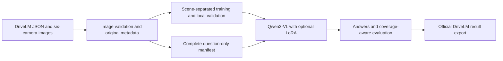

# Drive Scene Reasoner

[中文说明](README.zh-CN.md) · [Changelog](CHANGELOG.md) · [DriveLM compatibility](docs/DRIVELM_COMPATIBILITY.md)

A Qwen3-VL project for driving-scene question answering, following DriveLM-nuScenes data structures and result IDs. It provides six-camera data preparation, optional LoRA loading, training configuration and evaluation tools.

## Goal and status

The first goal is to answer questions from six synchronized camera views across four task families: perception, prediction, planning QA and ego-vehicle behavior.

Version **0.2** has verified CPU data workflows and regression tests. GPU inference, training quality and memory requirements remain unvalidated. The next milestones are a base-model benchmark on held-out scenes, a base-versus-LoRA comparison, and then stage-conditioned Graph VQA. Retaining graph fields does not implement graph execution.

## Framework



| Component | Responsibility |
| --- | --- |
| `src/drivescene/data.py`, `prepare.py` | Parse annotations, validate cameras/images, split scenes and preserve original metadata |
| `prompts.py`, `infer.py` | Shared user prompt and base-model/LoRA inference interface |
| `eval.py`, `protocol.py` | Prediction completeness, local metrics and official result export |
| `api.py` | Local HTTP API using prepared sample IDs |
| `configs/lora_qwen3vl8b.json`, `scripts/training_plan.py` | Training configuration, preflight checks, snapshots and resume |
| `scripts/download_assets.py`, `extract_dataset.py` | Resumable downloads, integrity checks and archive extraction |
| `tests/` | CPU regressions without loading real models |

Original QA fields, object boxes and source dependencies are retained in manifests and frame graph sidecars, never inserted into model user prompts. Missing dependencies are not invented.

## 1. Install and check the CPU workflow

Python 3.10+ is required; Python 3.11 is recommended. Examples use Linux/WSL Bash. Install Python's venv support or use a Conda environment; asset downloads also require `curl`.

```bash
git clone https://github.com/yojo0503/drive-scene-reasoner.git
cd drive-scene-reasoner

python3 -m venv .venv
source .venv/bin/activate
python -m pip install -e '.[dev]'
pytest -q

python scripts/make_toy_data.py --output data/toy
drivescene prepare --input data/toy/drivelm_train.json \
  --image-root data/toy/nuscenes \
  --output data/toy_processed --purpose sft --cameras all
```

This synthetic fixture checks data formatting without a GPU or weights. It is not a driving benchmark, and its outputs are kept separate from real prepared data.

## 2. Choose storage paths

These are example directories relative to the checkout. Replace them with your storage locations if needed, and set the variables again in new terminals.

```bash
export DATA_ROOT="$PWD/data/drivelm"
export MODEL_DIR="$PWD/checkpoints/Qwen3-VL-8B-Instruct"
```

`data/`, `checkpoints/` and `outputs/` are ignored by Git. Keep data, weights and credentials out of commits.

## 3. Download data and weights

Read the [official DriveLM instructions](https://github.com/OpenDriveLab/DriveLM/tree/main/challenge), obtain access to the [dataset](https://huggingface.co/datasets/OpenDriveLab/DriveLM), and log in with an approved Hugging Face account.

```bash
python -m pip install huggingface_hub
hf auth login

python scripts/download_assets.py \
  --repo OpenDriveLab/DriveLM --kind dataset \
  --revision ae973fbd4e8d4684af4ab234d504bd6c5e946868 \
  --include v1_1_train_nus.json v1_1_val_nus_q_only.json \
    drivelm_nus_imgs_train.zip drivelm_nus_imgs_val.zip \
  --output "$DATA_ROOT"

python scripts/extract_dataset.py \
  "$DATA_ROOT/drivelm_nus_imgs_train.zip" \
  "$DATA_ROOT/drivelm_nus_imgs_val.zip" \
  --output "$DATA_ROOT/images"

python scripts/download_assets.py \
  --repo Qwen/Qwen3-VL-8B-Instruct \
  --revision 0c351dd01ed87e9c1b53cbc748cba10e6187ff3b \
  --output "$MODEL_DIR"
```

Downloads resume and verify pinned upstream hashes, then create `asset_inventory.json`. Extraction checks ZIP paths and entry CRCs. Neither operation loads a model.

Training images extract to `images/nuscenes/samples/CAM_*/`; validation images extract to `images/val_data/CAM_*/`. Use the correct root for each annotation file.

## 4. Prepare labeled training and local validation

```bash
drivescene prepare --input "$DATA_ROOT/v1_1_train_nus.json" \
  --image-root "$DATA_ROOT/images/nuscenes" \
  --output data/processed --purpose sft \
  --cameras all --val-fraction 0.1 --seed 42
```

Outputs are train/val manifests, train/val Swift JSONL, `frame_graphs.jsonl` and `preparation.json`. The latter records source/output hashes, scene assignments and settings.

Splits are grouped by scene. All requested cameras must exist and decode successfully. `--cameras front` supports a front-only comparison, and `--limit-per-split` limits debugging subsets. `--allow-missing-images` is for format checks only and is rejected by training preflight.

## 5. Prepare official question-only inputs

```bash
drivescene prepare --input "$DATA_ROOT/v1_1_val_nus_q_only.json" \
  --image-root "$DATA_ROOT/images/val_data" \
  --output data/challenge --purpose infer --cameras all
```

This prepares `infer_manifest.jsonl` without running a model. It keeps all source question IDs and creates no SFT data. Official question-only inputs have no public answers and cannot be scored locally.

Empty answers are excluded from SFT. Blank questions retain their official IDs with `question_valid=false`; batch inference records an empty prediction and explicit status for them instead of invoking generation.

## 6. Run the base model or a LoRA adapter

Use a compatible NVIDIA GPU/PyTorch/CUDA environment. A dedicated Python 3.11 environment can use the [pinned GPU recipe](requirements/gpu-cu128.txt); runtime compatibility and memory fit still require validation. Explicitly select available devices with `CUDA_VISIBLE_DEVICES` before GPU execution.

```bash
python -m pip install -e '.[vision,lora]'
drivescene infer --manifest data/processed/val_manifest.jsonl \
  --model "$MODEL_DIR" --local-files-only \
  --min-pixels 65536 --max-pixels 262144 \
  --limit 0 --output outputs/predictions.jsonl
```

`--limit 0` processes the full manifest; `--limit 5` is a partial smoke run. Add `--adapter checkpoints/your_adapter` to load an existing LoRA checkpoint. Use `drivescene infer --help` for device and image-budget options.

## 7. Evaluate or export official results

```bash
drivescene eval --manifest data/processed/val_manifest.jsonl \
  --predictions outputs/predictions.jsonl

# 如需明确把漏答计为错误
drivescene eval --manifest data/processed/val_manifest.jsonl \
  --predictions outputs/predictions.jsonl --missing-policy wrong
```

Missing labeled predictions, duplicate IDs and unknown IDs are errors by default; reports include coverage. A partial smoke run cannot pass strict evaluation against a full manifest. Local Exact Match and token F1 are not the official combined score.

After running the model on `data/challenge/infer_manifest.jsonl` and saving complete predictions to `outputs/challenge_predictions.jsonl`, export them with:

```bash
drivescene export-official --manifest data/challenge/infer_manifest.jsonl \
  --predictions outputs/challenge_predictions.jsonl \
  --output outputs/official_output.json
```

Export requires every manifest prediction. `eval-tag0` requires existing tags and labeled answers; it omits upstream graph eligibility filtering and combined scoring. See the [compatibility notes](docs/DRIVELM_COMPATIBILITY.md).

## 8. Validate a LoRA training plan

```bash
bash scripts/train_lora.sh --dry-run --model "$MODEL_DIR"
```

The planner reads `configs/lora_qwen3vl8b.json`, checks validation data, scene separation, image validation and artifact hashes, and prints the command without loading a model. Use `--config` and CLI overrides to change settings.

Actual training additionally requires `--execute`, tmux, a clean Git commit and explicit `CUDA_VISIBLE_DEVICES` matching the GPU count. It saves configuration/package/data snapshots and supports `--resume-from-checkpoint`. The starting recipe is not a proven memory-fitting configuration.

## 9. Use the local HTTP API

```bash
python -m pip install -e '.[api]'
DRS_MANIFEST=data/challenge/infer_manifest.jsonl \
  uvicorn drivescene.api:app --host 127.0.0.1 --port 8000
```

`GET /health` and `GET /v1/samples` work without a model. `POST /v1/reason` accepts a `sample_id` from the prepared manifest. Model answers require vision dependencies, `DRS_MODEL_ID` and explicit `DRS_ENABLE_MODEL=1`; `DRS_ADAPTER` optionally selects a LoRA checkpoint.

## Attribution

Upstream references are pinned in `configs/upstream.json`. No DriveLM annotations, images or model weights are bundled. DriveLM language data is CC BY-NC-SA 4.0; nuScenes has separate terms. See [upstream notices](docs/UPSTREAM.md). This repository's original code has no project license selected yet.
