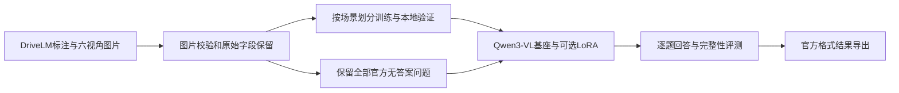

# Drive Scene Reasoner 中文说明

当前版本为 **0.2**。本次补齐了五项工程问题，并验证 CPU 数据流程；没有运行真实模型加载、推理、训练或付费评测。

## 当前目标

第一阶段目标是实现与 DriveLM-nuScenes 同类的驾驶场景多模态问答：输入同一时刻的六路摄像头图片和问题，由 Qwen3-VL 给出回答，覆盖四类任务。

| 任务 | 要解决的问题 |
| --- | --- |
| 感知 perception | 场景里有哪些车辆、行人、信号灯，它们是什么状态？ |
| 预测 prediction | 相关交通参与者接下来可能怎样运动？ |
| 规划问答 planning | 自车适合采取什么行为，理由是什么？ |
| 自车行为 behavior | 自车当前的运动与驾驶行为是什么？ |

当前已完成数据和工程准备。下一阶段才验证真实 GPU 推理、显存与耗时，再比较基座模型和 LoRA 微调后的问答效果；随后研究问题之间的分阶段依赖推理。本轮没有执行这些 GPU 工作。

## 项目框架



| 文件或目录 | 作用 |
| --- | --- |
| src/drivescene/data.py、prepare.py | 读取原始标注、检查六视角、划分场景、生成数据和原始问题结构文件 |
| prompts.py、infer.py | 统一用户提示词，提供基座及 LoRA 推理入口 |
| eval.py、protocol.py | 检查结果完整性、计算本地指标、导出官方结果 ID |
| api.py | 用已有样本 ID 提供本地 HTTP 问答接口 |
| scripts/training_plan.py、configs/lora_qwen3vl8b.json | 检查训练计划，管理验证集、图像预算、断点与版本快照 |
| scripts/download_assets.py、extract_dataset.py | 下载、哈希校验和安全解压 |
| tests/ | 不执行真实模型的 CPU 回归测试 |

详细更新记录见 [CHANGELOG.md](CHANGELOG.md)。

## 已完成的更新

1. **六视角严格检查**：选择 all 时必须有六路摄像头；默认解码每张图片，记录尺寸，损坏图片立即报错。
2. **完整评测**：重复 ID、未知 ID、缺失预测默认报错。只有明确选择 missing-policy wrong 时才把漏答计错，报告同时显示覆盖率。
3. **无答案数据保留**：purpose infer 保留所有问题，不划分训练/验证，不生成训练文件。purpose sft 专用于有答案数据。
4. **保留 DriveLM 原始结构**：原始问答字段、问题依赖、分组、层级、对象框和场景信息都会保留。每个样本同时有内部 ID 和官方 ID；筛选样本不会重新编号。frame_graphs.jsonl 保留被选中帧的完整原始问题。
5. **补齐微调后使用流程**：推理接口支持“基座模型 + LoRA 参数”；训练与推理使用同一用户提示词；训练配置包含独立验证集、图像预算、随机种子、版本快照和断点续训。

保留图结构信息不等于已经实现分阶段 Graph VQA 推理。本次没有根据标注猜测依赖，也没有把标注答案、对象说明或场景描述偷偷加入模型输入。

## 在服务器使用

```bash
cd /home/yyh/Github/drive-scene-reasoner
source .venv/bin/activate
pytest -q
```

现有 .venv 用于 CPU 数据与工程检查。GPU 依赖请将来在独立 Python 3.11 环境中按 requirements/gpu-cu128.txt 安装，不要直接套用现有 CPU 环境。

服务器实际资源位置与检查结果见 [SERVER_SETUP.md](docs/SERVER_SETUP.md)。

服务器已准备好全量清单：data/processed 下有 339,357 条训练样本和 38,598 条本地有标签验证样本，data/challenge 下有 15,480 条官方无答案问题。下面的 prepare 命令用于需要重新生成数据时；正常使用可以直接读取现有清单。

## 准备有答案数据

```bash
drivescene prepare --input /home/yyh/datasets/DriveLM/v1.1/v1_1_train_nus.json \
  --image-root /home/yyh/datasets/DriveLM/v1.1/images/nuscenes \
  --output data/processed --purpose sft --cameras all
```

输出训练和验证的 manifest、Swift 训练文件、原始问题结构文件、preparation.json。按原始场景划分，记录文件哈希和划分结果。

## 准备官方无答案问题

```bash
drivescene prepare --input /home/yyh/datasets/DriveLM/v1.1/v1_1_val_nus_q_only.json \
  --image-root /home/yyh/datasets/DriveLM/v1.1/images/val_data \
  --output data/challenge --purpose infer --cameras all
```

这里只处理数据，不会执行推理。输出 infer_manifest.jsonl；不能用这个无答案文件计算本地准确率。

官方 v1.1 无答案文件包含 1 条空问题。项目保留其原始编号并标记 question_valid=false；训练准备会排除空问题。将来批量推理遇到这条记录时会保存空预测及异常状态，不会改写问题或为它调用模型生成。

## 评测与官方结果导出

```bash
drivescene eval --manifest data/processed/val_manifest.jsonl \
  --predictions outputs/predictions.jsonl
drivescene export-official --manifest data/challenge/infer_manifest.jsonl \
  --predictions outputs/challenge_predictions.jsonl --output outputs/official_output.json
```

本地指标仍是答案完全匹配率和词语重合得分。eval-tag0 只计算已有 tag=0 标记题目的严格字符串匹配，不包含官方图依赖筛选和综合分数。完整差异见 [DriveLM 对齐说明](docs/DRIVELM_COMPATIBILITY.md)。

## 训练计划检查

```bash
bash scripts/train_lora.sh --dry-run
```

默认只检查并打印命令，不加载模型。实际配置在 configs/lora_qwen3vl8b.json，支持命令行覆盖。将来执行训练时还需显式传入 --execute、进入 tmux，并指定空闲 GPU。当前没有证明这套 8B 六视角配置能在两张 3090 上稳定训练；包版本也尚未完成 GPU 环境联合验证。

项目沿用 Qwen3-VL，并按 DriveLM 的数据与结果接口组织。它没有完整复制官方旧版 LLaMA-Adapter 工程，也没有宣称达到原模型效果。

## 后续如何运行模型

以下是将来 GPU 阶段的使用说明，本次未执行。先在独立 Python 3.11 环境中按 requirements/gpu-cu128.txt 安装依赖，再安装项目及推理扩展。执行前通过 CUDA_VISIBLE_DEVICES 明确选择可用 GPU。

```bash
pip install -e '.[vision,lora,api]'
drivescene infer --manifest data/processed/val_manifest.jsonl \
  --model /home/yyh/models/Qwen3-VL-8B-Instruct \
  --local-files-only --min-pixels 65536 --max-pixels 262144 \
  --limit 0 --output outputs/predictions.jsonl
```

将来有 LoRA 检查点后，在同一条命令增加 --adapter 并指定检查点目录。--limit 0 处理整个清单；--limit 5 只做少量检查，不能直接拿它的部分输出与完整验证集计算严格评测。

## 本地接口如何使用

```bash
pip install -e '.[api]'
DRS_MANIFEST=data/challenge/infer_manifest.jsonl \
  uvicorn drivescene.api:app --host 127.0.0.1 --port 8000
```

GET /health 查看状态，GET /v1/samples 查看样本，两者不加载模型。POST /v1/reason 接收 sample_id；真正的 GPU 回答还需安装推理依赖、配置 DRS_MODEL_ID，并显式设置 DRS_ENABLE_MODEL=1。DRS_ADAPTER 可指定 LoRA 参数。本次没有启动该服务。
