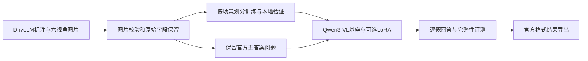

# Drive Scene Reasoner

基于 Qwen3-VL 的驾驶场景多模态问答项目，参考 DriveLM-nuScenes 的数据结构和结果协议，提供六视角数据准备、问答推理接口、LoRA 微调入口与评测工具。

[English](README.md) · [更新记录](CHANGELOG.md) · [DriveLM 对齐说明](docs/DRIVELM_COMPATIBILITY.md) · [逐文件说明](docs/FILE_GUIDE.zh-CN.md) · [GPU 环境](docs/GPU_ENVIRONMENT.md)

## 当前目标与进度

第一阶段目标：输入同一时刻的六路摄像头图片和一个问题，输出驾驶场景回答，覆盖以下任务。

| 任务 | 问题示例 |
| --- | --- |
| 感知 perception | 前方有哪些车辆、行人或信号灯，它们处于什么状态？ |
| 预测 prediction | 相关车辆或行人接下来可能怎样运动？ |
| 规划问答 planning | 自车适合采取什么行为，为什么？ |
| 自车行为 behavior | 自车当前的运动与驾驶行为是什么？ |

当前版本为 **0.2**：数据处理和 CPU 回归测试已验证，提供 Qwen3-VL 与 LoRA 的加载接口及训练配置。真实 GPU 推理、训练效果和显存需求仍待验证。后续先建立基座模型的问答基线，再比较 LoRA 微调效果，之后研究分阶段 Graph VQA（让感知、预测、规划问题按依赖关系串联推理）。

## 项目框架



| 文件或目录 | 作用 |
| --- | --- |
| `src/drivescene/data.py`、`prepare.py` | 读取标注、检查图片、划分场景、保留原始问题结构 |
| `prompts.py`、`infer.py` | 统一用户提示词，提供基座与 LoRA 推理接口 |
| `eval.py`、`protocol.py` | 检查预测完整性、计算本地指标、导出官方结果 |
| `api.py` | 通过已有样本 ID 提供本地 HTTP 接口 |
| `configs/lora_qwen3vl8b.json` | 训练数据、图像预算、随机种子等配置 |
| `scripts/training_plan.py` | 检查训练计划，保存运行配置并支持断点续训 |
| `scripts/download_assets.py`、`extract_dataset.py` | 下载、校验和解压数据及模型 |
| `tests/` | 不加载真实模型的 CPU 回归测试 |

原始问答字段、对象框及问题依赖保存在数据清单与 `frame_graphs.jsonl` 中，不加入模型的用户提示词。保留这些信息不代表已经实现图推理；项目也不生成原标注中不存在的依赖关系。

## 1. 安装与 CPU 快速检查

要求 Python 3.10+，推荐 Python 3.11。以下命令使用 Linux / WSL 的 Bash；下载工具还需要 `curl`。创建虚拟环境需安装对应 Python 的 venv 支持，也可以使用 Conda 环境。

```bash
git clone https://github.com/yojo0503/drive-scene-reasoner.git
cd drive-scene-reasoner

python3 -m venv .venv
source .venv/bin/activate
python -m pip install -e '.[dev]'

pytest -q
python scripts/make_toy_data.py --output data/toy
drivescene prepare --input data/toy/drivelm_train.json \
  --image-root data/toy/nuscenes \
  --output data/toy_processed --purpose sft --cameras all
```

该流程生成合成图片并检查数据格式，不需要 GPU 或模型权重。合成数据不能用于判断驾驶问答效果，输出与真实数据分开存放。

## 2. 设置数据和模型位置

以下位置是项目内的示例目录，也可以改为自己的存储位置。后续命令使用相同变量；新终端中需要重新设置。

```bash
export DATA_ROOT="$PWD/data/drivelm"
export MODEL_DIR="$PWD/checkpoints/Qwen3-VL-8B-Instruct"
```

`data/`、`checkpoints/`、`outputs/` 已被 Git 忽略。不要把原始数据、权重或访问凭据提交到仓库。

## 3. 获取真实数据与模型

先阅读 [DriveLM 官方数据说明](https://github.com/OpenDriveLab/DriveLM/tree/main/challenge)，申请 [DriveLM 数据集](https://huggingface.co/datasets/OpenDriveLab/DriveLM)的访问权限，并在本机登录获批的 Hugging Face 账号。

```bash
python -m pip install huggingface_hub
hf auth login

python scripts/download_assets.py \
  --repo OpenDriveLab/DriveLM --kind dataset \
  --revision ae973fbd4e8d4684af4ab234d504bd6c5e946868 \
  --include v1_1_train_nus.json v1_1_val_nus_q_only.json \
    drivelm_nus_imgs_train.zip drivelm_nus_imgs_val.zip \
  --output "$DATA_ROOT"

python scripts/extract_dataset.py \
  "$DATA_ROOT/drivelm_nus_imgs_train.zip" \
  "$DATA_ROOT/drivelm_nus_imgs_val.zip" \
  --output "$DATA_ROOT/images"

python scripts/download_assets.py \
  --repo Qwen/Qwen3-VL-8B-Instruct \
  --revision 0c351dd01ed87e9c1b53cbc748cba10e6187ff3b \
  --output "$MODEL_DIR"
```

下载工具支持续传并校验固定版本的文件哈希，生成 `asset_inventory.json`；解压工具检查 ZIP 路径与条目 CRC。下载与解压不加载模型。

官方两个图像包的目录不同，解压后应得到：

```text
data/drivelm/
├── v1_1_train_nus.json
├── v1_1_val_nus_q_only.json
└── images/
    ├── nuscenes/samples/CAM_*/    # 训练图片
    └── val_data/CAM_*/            # 官方验证图片
```

## 4. 准备训练集和本地验证集

```bash
drivescene prepare --input "$DATA_ROOT/v1_1_train_nus.json" \
  --image-root "$DATA_ROOT/images/nuscenes" \
  --output data/processed --purpose sft \
  --cameras all --val-fraction 0.1 --seed 42
```

输出包括：

- `train_manifest.jsonl`、`val_manifest.jsonl`：样本、标签、图片及原始元数据。
- `train_swift.jsonl`、`val_swift.jsonl`：供 ms-swift 使用的图文训练数据。
- `frame_graphs.jsonl`：被选中帧的完整原始问题及结构字段。
- `preparation.json`：来源哈希、文件哈希、场景划分、参数与数量。

训练和验证按 **scene（场景）** 划分，避免同一场景的问题混入两个集合。六视角模式要求图片齐全且可解码。`--cameras front` 可用于前视角对照实验；`--limit-per-split` 可限制调试样本数。`--allow-missing-images` 仅用于格式检查，不能用于实际训练准备。

## 5. 准备官方无答案问题

```bash
drivescene prepare --input "$DATA_ROOT/v1_1_val_nus_q_only.json" \
  --image-root "$DATA_ROOT/images/val_data" \
  --output data/challenge --purpose infer --cameras all
```

生成 `infer_manifest.jsonl`，保留全部问题和原始官方 ID，不生成训练文件。这个命令只准备数据，不执行模型推理。官方问题集没有公开答案，不能直接计算本地准确率。

v1.1 源文件中的空答案和空问题会被显式处理：空答案不用于有监督训练；空问题保留官方 ID 并标记 `question_valid=false`。批量推理遇到空问题时保存空预测及异常状态，不为它调用模型生成。

## 6. 运行基座模型或 LoRA 推理

需要 NVIDIA GPU 和兼容的 PyTorch/CUDA 环境。可在独立 Python 3.11 环境中参考 [GPU 关键依赖版本](requirements/gpu-cu128.txt)安装，再安装项目扩展；该组合已通过依赖导入和 CUDA 基础检查，见 [环境验证记录](docs/GPU_ENVIRONMENT.md)；完整模型运行与实际显存需求仍待验证。执行前用 `CUDA_VISIBLE_DEVICES` 明确选择可用 GPU。

```bash
python -m pip install -e '.[vision,lora]'

drivescene infer --manifest data/processed/val_manifest.jsonl \
  --model "$MODEL_DIR" --local-files-only \
  --min-pixels 65536 --max-pixels 262144 \
  --limit 0 --output outputs/predictions.jsonl
```

`--limit 0` 处理整个清单；`--limit 5` 只做少量检查。LoRA 微调后，在命令中增加 `--adapter checkpoints/your_adapter`，加载对应检查点。图像预算、设备映射等参数可通过 `drivescene infer --help` 查看。

## 7. 评测与官方结果导出

```bash
drivescene eval --manifest data/processed/val_manifest.jsonl \
  --predictions outputs/predictions.jsonl

# 如需明确把漏答计为错误
drivescene eval --manifest data/processed/val_manifest.jsonl \
  --predictions outputs/predictions.jsonl --missing-policy wrong
```

默认拒绝漏答、重复 ID 和未知 ID，并报告覆盖率。少量调试预测不能直接用于完整验证集的严格评测。本地指标是答案完全匹配率和词语重合得分，不等同于官方综合得分。

如需生成官方格式结果，先对 `data/challenge/infer_manifest.jsonl` 完成推理，并将输出保存为 `outputs/challenge_predictions.jsonl`，再执行：

```bash
drivescene export-official --manifest data/challenge/infer_manifest.jsonl \
  --predictions outputs/challenge_predictions.jsonl \
  --output outputs/official_output.json
```

导出要求清单内预测完整。`eval-tag0` 只支持已有题型标签和答案的记录，不包含官方图筛选及综合分数。完整边界见 [DriveLM 对齐说明](docs/DRIVELM_COMPATIBILITY.md)。

## 8. 检查 LoRA 训练计划

```bash
bash scripts/train_lora.sh --dry-run --model "$MODEL_DIR"
```

默认读取 `configs/lora_qwen3vl8b.json`，检查训练/验证文件、图片校验状态、场景隔离及数据哈希，只打印命令，不加载模型。可使用 `--config` 或命令行参数调整配置。

实际训练还需显式传入 `--execute`、进入 tmux、保持代码提交干净，并设置与 GPU 数量对应的 `CUDA_VISIBLE_DEVICES`。执行时保存运行参数、依赖版本和数据哈希；`--resume-from-checkpoint` 支持续训。不要将该起始配置理解为已验证的显存适配方案。

## 9. 本地 HTTP 接口

```bash
python -m pip install -e '.[api]'
DRS_MANIFEST=data/challenge/infer_manifest.jsonl \
  uvicorn drivescene.api:app --host 127.0.0.1 --port 8000
```

- `GET /health`：服务状态。
- `GET /v1/samples`：查询可用样本及其 ID。
- `POST /v1/reason`：请求体提供 `sample_id`，回答该样本的问题。

前两个接口不加载模型。模型回答还需安装推理依赖，配置 `DRS_MODEL_ID` 并设置 `DRS_ENABLE_MODEL=1`；`DRS_ADAPTER` 可指定 LoRA 检查点。

## 上游与许可

项目使用独立实现的数据适配器和 Qwen3-VL 接口，参考版本见 `configs/upstream.json`。仓库不包含 DriveLM 标注、图像或模型权重。DriveLM 语言标注采用 CC BY-NC-SA 4.0，nuScenes 另有数据条款；详见 [上游说明](docs/UPSTREAM.md)。项目原创代码的许可证尚未选定。
