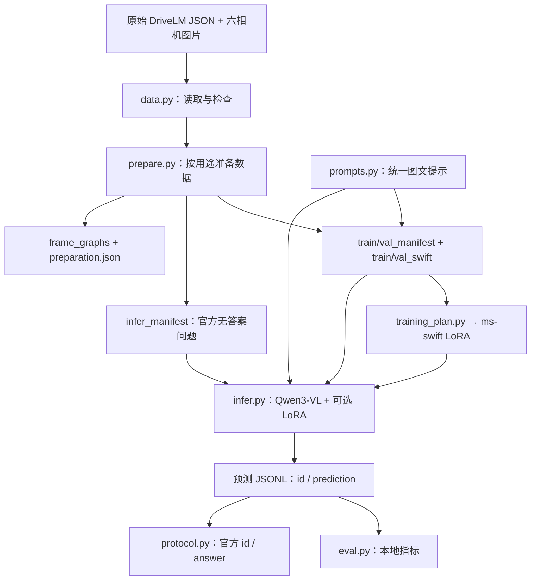

# DriveLM 与服务器项目逐文件说明

> 环境更新：GPU 环境的最新安装与验证状态请查看 [GPU_ENVIRONMENT.md](GPU_ENVIRONMENT.md)。下文文件清单和历史状态是整理时的快照。

> 整理日期：2026-10-22（Asia/Shanghai）。依据 `yyh@222.201.145.7` 上的实际目录、Git 索引、源代码和已有产物整理。以下统计为本文生成前的快照。

## 1. 先分清两个项目

服务器实际项目根目录是 `/home/yyh/Github/drive-scene-reasoner`。里面的 `third_party/DriveLM` 是官方参考仓库，两者使用不同模型与训练工具。

| 项目 | 位置与版本 | 主要作用 |
| --- | --- | --- |
| 你的项目 drive-scene-reasoner | `/home/yyh/Github/drive-scene-reasoner`；提交 `b016dc85310d49707431e0f5beb96784056fea3e` | 基于 Qwen3-VL-8B 的六视角驾驶问答，提供数据准备、LoRA 入口、推理、评测与 HTTP API。 |
| 官方 DriveLM | 上述目录下的 `third_party/DriveLM`；提交 `1de72a74b257e5373400fa68239e99bd5d20580a` | 官方数据/图问答说明、挑战赛数据转换与评测、早期 LLaMA-Adapter V2 基线。 |

上游来源：[DriveLM 固定版本](https://github.com/OpenDriveLab/DriveLM/tree/1de72a74b257e5373400fa68239e99bd5d20580a)。外层项目来源：[drive-scene-reasoner](https://github.com/yojo0503/drive-scene-reasoner/tree/b016dc85310d49707431e0f5beb96784056fea3e)。

### 覆盖范围与核查方式

共逐项说明 **250 个文件条目**：

| 范围 | 条目数 | 说明 |
| --- | ---: | --- |
| 外层项目 Git 文件 | 43 | 源码、脚本、配置、测试、文档和占位文件，全部存在于服务器工作目录。 |
| 官方 DriveLM Git 文件 | 142 | 60 个已检出，82 个因稀疏检出未展开；未展开的文本通过该提交的 Git 对象读取。 |
| 外层 data/ 与 outputs/ 现有产物 | 65 | 预处理数据、18 张合成图片、报告、日志和归档；已被 Git 忽略。 |

官方仓库的稀疏检出列表是 `docs`、`challenge/data`、`challenge/llama_adapter_v2_multimodal7b/data/nuscenes`。因此“在 Git 中有这个文件”不代表当前能在服务器路径下直接打开。第 5 节逐项注明 **已检出 / 未检出**，未改变原有稀疏检出配置。

本文不逐项列出 `.git/` 内部对象、`.venv/` 中第三方安装包、`__pycache__/`、`.pytest_cache/` 和安装元数据。这些是版本管理或工具自动维护文件，不是本项目自行实现的功能。项目根目录之外的全量模型权重、原始数据与数万张图片也不逐张展开，路径见第 7 节。

源码和配置按实际内容分析；大型 JSON/JSONL 核对结构、样本及生成代码，没有逐条复核全部标注。图片/视频主要按文件路径及文档引用说明用途，未逐张做视觉语义审查或播放全部视频。归档包仅记录用途线索和文件元信息。

## 2. 目录地图与主流程

```text
/home/yyh/Github/drive-scene-reasoner/
├── README.zh-CN.md          中文使用入口
├── pyproject.toml          包安装、依赖、drivescene 命令
├── configs/                模型版本、训练参数和实验矩阵
├── src/drivescene/         Qwen3-VL 项目的核心实现
├── scripts/                下载、审计、数据解压和训练入口
├── tests/                  CPU 回归测试
├── docs/                   架构、兼容性、部署和设计记录
├── data/                   训练、验证、官方推理及演示数据清单
├── outputs/                检查报告、日志和本说明文件
└── third_party/DriveLM/    官方参考仓库（部分文件未检出）
```

### 2.1 外层 Qwen3-VL 流程



`cli.py` 负责命令行调度；`api.py` 则提供另一种访问已准备样本和推理模型的方式。

### 2.2 官方原基线流程

```text
challenge/data/train_sample.json
  → extract_data.py → test.json
  → convert_data.py → test_eval.json
  → convert2llama.py → test_llama.json
  → LLaMA-Adapter 的 demo.py → output.json
  → evaluation.py + test_eval.json → 综合评测分数
  → prepare_submission.py → submission.json
```

这条是官方小样本演示链。实际比赛使用完整官方问题集，不能用示例的 66 条预测替代完整提交。外层 Qwen 项目通过自己的数据适配和结果导出与官方协议衔接，不会自动调用官方 LLaMA 训练入口。

## 3. 外层项目：43 个受 Git 管理的文件

本节路径均相对于 `/home/yyh/Github/drive-scene-reasoner`。每行对应一个文件。

### 3.1 根目录与仓库配置

| 文件路径 | 用途与关键内容 |
| --- | --- |
| `.gitattributes` | 规定文本文件使用 LF 换行，保证 Linux 服务器与 Windows 工作副本的换行一致。 |
| `.github/workflows/ci.yml` | GitHub Actions 的 CPU 检查流程：Python 3.11 安装开发依赖，运行 pytest、源码编译检查和训练 Shell 语法检查；不加载真实模型。 |
| `.gitignore` | 排除虚拟环境、缓存、权重、数据、训练输出与 third_party 目录，只保留 data/.gitkeep。 |
| `CHANGELOG.md` | 记录版本迭代及 v0.2 的数据对齐、推理接口、评测和服务器准备变更，帮助了解功能的来历。 |
| `README.md` | 英文项目使用入口，说明安装、资源下载、数据准备、推理、评测、LoRA 与 HTTP API 的完整流程。 |
| `README.zh-CN.md` | 中文项目使用入口，与英文 README 对应；初次阅读项目建议从此文件开始。 |
| `pyproject.toml` | Python 包的构建、版本与依赖定义；区分 dev/vision/lora/api 可选依赖；将 drivescene 命令映射到 drivescene.cli:main，并指定 pytest 目录。 |


### 3.2 配置与依赖

| 文件路径 | 用途与关键内容 |
| --- | --- |
| `configs/experiments.yaml` | 前视角/六视角 × 基座/LoRA 的四组对照实验矩阵及拟记录指标。仅表达实验设计，训练入口实际读取 JSON 配置。 |
| `configs/lora_qwen3vl8b.json` | training_plan.py 的默认训练配置：Qwen3-VL-8B、训练/验证 JSONL、2 GPU、每图 64–256 token、序列 4096、seed=42 和输出目录。 |
| `configs/upstream.json` | 固定 DriveLM 源码、Qwen 模型、Hugging Face 数据集提交，以及 ms-swift 4.6.0，便于复现与核对来源。 |
| `requirements/gpu-cu128.txt` | Linux Python 3.11/CUDA 12.8 的 GPU 依赖版本配方，包括 torch、transformers、peft、ms-swift、deepspeed 等；文件本身说明实际 GPU 执行尚未验证。 |


### 3.3 核心源码

| 文件路径 | 用途与关键内容 |
| --- | --- |
| `src/drivescene/__init__.py` | 声明 drivescene Python 包及版本号 0.2.0。 |
| `src/drivescene/api.py` | FastAPI 本地服务：health 查询状态，samples 列举样本，reason 按 sample_id 回答问题。缓存清单与模型，使用 DRS_* 环境变量配置；只有显式启用模型后才允许生成。 |
| `src/drivescene/cli.py` | 统一命令行入口，解析 prepare、infer、eval、export-official、eval-tag0 参数并调度模块；批量推理写出 id/prediction JSONL，空问题保留 ID 并记录异常状态。 |
| `src/drivescene/data.py` | 核心数据适配层：QARecord 表示题目；load_drivelm 展开 scene/key_frames/QA，生成内部 ID 和官方 ID；解析图片路径、验证相机/图像、按场景划分、组装样本及 ms-swift SFT 格式，并提供 JSONL 读写。 |
| `src/drivescene/eval.py` | 本地评测：检查重复、未知和缺失预测，计算答案规范化后的 exact match 与 token F1，汇总整体/分任务指标及覆盖率；无公开答案的数据不能在这里得到准确率。 |
| `src/drivescene/infer.py` | QwenVLReasoner 模型封装：加载 Qwen3-VL、可选 PEFT LoRA 和处理器；校验图像预算，读取多相机图片，构造多模态输入，确定性生成并解码新增 token。 |
| `src/drivescene/prepare.py` | 数据准备主流程：区分有答案 SFT 与无答案 infer，筛选任务/样本，写出 manifest、Swift 数据、frame_graphs 和 preparation.json；记录来源与产物 SHA256、场景划分及统计。 |
| `src/drivescene/prompts.py` | 训练和推理共享的提示词定义：按固定相机顺序插入图像及问题；multimodal_content 转换为文本/图像消息，避免把问题正文中的 `<image>` 当作图片占位符。 |
| `src/drivescene/protocol.py` | 官方格式适配：校验完整预测，将内部 id 映射为官方 id，导出 id/answer 列表；另实现带标签样本的严格 tag-0 字符串准确率，不包含官方图筛选。 |


### 3.4 辅助脚本与训练入口

| 文件路径 | 用途与关键内容 |
| --- | --- |
| `scripts/audit_dataset.py` | CPU 数据审计入口：读取全部 QA，检查内部/官方 ID 唯一性，按帧校验六相机图片，输出场景、帧、题数、图片尺寸、空问题和依赖字段统计 JSON。 |
| `scripts/audit_model_files.py` | 读取模型配置、资源清单、权重索引及 safetensors 头部，核对分片大小、张量名称/偏移、参数量和处理器文件；不加载张量进行推理。 |
| `scripts/download_assets.py` | 下载固定版本的 Hugging Face 模型或数据。支持筛选文件、续传、并行分段、哈希验证和 verify-only；生成 asset_inventory.json，记录资源来源及 SHA256。 |
| `scripts/extract_dataset.py` | 解压 DriveLM 图像 ZIP，检查目录越界和符号链接，验证大小/CRC，支持跳过已验证文件，并记录 extraction_inventory.json。 |
| `scripts/make_toy_data.py` | 生成 3 个场景、每场景 6 张合成 PNG 和示例问答，用于验证数据格式及命令流程；图片不是实际道路采集数据。 |
| `scripts/publish_with_gh.sh` | 通过 GitHub CLI 初始化、提交并创建远程仓库，默认私有；属于发布辅助脚本，执行会进行 git add/commit 和远程 push。 |
| `scripts/train_lora.sh` | 很薄的 Bash 入口：定位项目根目录，以 PYTHON 指定的解释器或默认 python 转交给 training_plan.py，并透传参数。 |
| `scripts/training_plan.py` | 训练计划与启动控制中心：检查准备报告哈希、场景隔离、图片和标签，拼装 swift sft 命令。默认仅打印计划；execute 时要求 tmux、干净代码和明确 GPU，保存运行配置/依赖快照，并支持完整检查点续训。 |


### 3.5 测试

| 文件路径 | 用途与关键内容 |
| --- | --- |
| `tests/conftest.py` | pytest 公共 fixture：临时生成 3 个场景的六相机图片、QA、对象框和依赖字段，供测试复用。 |
| `tests/test_alignment.py` | 覆盖六视角完整性、图片可解码、原始字段与双 ID、提示词不泄漏标注、按场景划分、无答案/空问题、官方导出、tag-0、图旁路保留及旧产物冲突。 |
| `tests/test_assets.py` | 检查 ZIP 安全路径、CRC 重解压，以及分段下载的续传/拼接和服务器忽略 Range 时的报错；网络请求被模拟。 |
| `tests/test_data.py` | 检查基础 DriveLM 加载、按场景确定性划分、前相机样本构造、两种图片根目录和无答案记录读取。 |
| `tests/test_eval.py` | 检查规范化、token F1、只统计有答案参考记录等本地指标行为。 |
| `tests/test_model_contract.py` | 用假 torch/transformers/peft 模块检查基座与 LoRA 的参数传递、图像预算和早期校验；不证明真实 GPU 推理已通过。 |
| `tests/test_training_plan.py` | 验证训练计划包含显式验证集、图像预算和续训约束，并确保准备数据被篡改后哈希检查失败。 |


### 3.6 文档与数据占位

| 文件路径 | 用途与关键内容 |
| --- | --- |
| `data/.gitkeep` | 空占位文件，让 Git 保留 data 目录；不包含数据。 |
| `docs/ARCHITECTURE.md` | 说明数据到模型的模块链路与约束：双 ID、六相机顺序、场景划分、元数据隔离和训练快照；列出尚未实现的研究功能。 |
| `docs/DRIVELM_COMPATIBILITY.md` | 详细界定与官方 DriveLM 的数据、ID、导出格式和评测兼容范围；强调本地指标、tag-0 子集与官方综合评测的差异。 |
| `docs/ROADMAP.md` | 列出已完成工程能力和后续 GPU 基线、LoRA、图推理及完整评测的研究计划。 |
| `docs/SERVER_SETUP.md` | 2026-10-21 的服务器部署记录：真实模型/数据路径、下载和解码检查、样本规模、历史 CPU 测试结果及 GPU 环境建议。 |
| `docs/UPSTREAM.md` | 记录 DriveLM 等上游来源、引用与许可说明，以及在忽略目录中放置参考仓库的方式。 |
| `docs/superpowers/plans/2026-10-21-drivelm-alignment.md` | DriveLM 对齐任务的历史实施清单与完成标记，用于理解数据、评测、资源和训练准备各项改动。 |
| `docs/superpowers/specs/2026-10-21-drivelm-alignment-design.md` | 对应实施清单的设计文档：定义字段保留、无答案数据、官方 ID、图结构旁路文件和训练复现等要求。 |


## 4. 核心代码怎样配合

### 4.1 数据字段与两种 ID

`data.py` 中 `load_drivelm()` 将嵌套 JSON 展开为 `QARecord`。每题同时有两种标识：

- 内部 ID：`scene_id:frame_id:task:task_local_index`，供项目内部清单和预测使用。
- 官方 ID：`scene_id_frame_id_frame_global_index`，题号按 perception → prediction → planning → behavior 的顺序在帧内连续递增。

`prepare.py` 在筛选任务或限制数量之前取得官方 ID，所以筛选后不会重新编号。`protocol.py` 导出时读取这个映射，而不是用输出行号生成 ID。

相机顺序在 `data.py` 中固定为：CAM_FRONT、CAM_FRONT_LEFT、CAM_FRONT_RIGHT、CAM_BACK、CAM_BACK_LEFT、CAM_BACK_RIGHT。`front` 模式只选择 CAM_FRONT；`all` 模式要求六张都存在且能够解码。

### 4.2 manifest、Swift 文件、graph 文件分别存什么

| 文件类型 | 存放内容 | 主要消费者 |
| --- | --- | --- |
| `*_manifest.jsonl` | ID、问题、答案、相机/图片、场景/帧、验证状态和原始元数据 | 推理、评测、训练计划检查 |
| `*_swift.jsonl` | `messages` 与 `images`；用户消息是统一提示，助手消息是答案 | ms-swift SFT |
| `frame_graphs.jsonl` | 每帧所有原始 QA 节点、字段及哪些节点进入清单 | 数据追溯、后续图推理研究 |
| `preparation.json` | 用途、源哈希、划分、统计、图片检查状态、产物哈希 | 训练可复现检查 |

原始 QA、对象框、场景描述会保留在清单/旁路文件中，但不会直接拼入模型用户提示。当前的 `frame_graphs.jsonl` 是保存结构信息的容器，不是一个已经运行的分阶段图推理引擎。

### 4.3 训练入口的实际职责

`train_lora.sh` 调用 `training_plan.py`。`build_plan()` 先检查 train/val 来自同一次 SFT 准备、哈希未变、场景不重叠、图片有效，然后生成 `swift sft` 命令。

当前实现写入的起始训练参数包括 LoRA rank=16、alpha=32、冻结 ViT/aligner、每设备 batch=1、梯度累积=8、学习率 1e-4、2 epochs；超过 1 个 GPU 时添加 DeepSpeed ZeRO-3。部分参数在 JSON 中可改，其他参数目前写在 `build_plan()` 中。

默认运行只输出计划。真正执行时，程序还检查 tmux、代码工作区、CUDA_VISIBLE_DEVICES 和 ms-swift 版本，保存 `run_plan.json` / `resume_plan.json` 及 `pip-freeze.txt`。续训要求完整训练状态，不仅是 LoRA 权重目录。当前设置仍需真实 GPU 实验验证显存和效果。

### 4.4 推理、HTTP API 与评测边界

`infer.py` 的 `QwenVLReasoner` 用 Transformers 加载 Qwen3-VL；传入 adapter 时再用 PEFT 加载 LoRA。`generate()` 使用 `prompts.py` 组装多相机消息并返回新增 token 解码后的文本。

`api.py` 基于已准备的 sample_id 工作。健康检查和样本列表不加载模型；回答接口按需初始化模型，且需要设置 `DRS_ENABLE_MODEL=1`。CLI 遇到空问题时保留其 ID、写空预测和状态，不为该题执行生成；CLI 自身仍在处理列表前初始化模型。

`eval.py` 计算规范化 exact match 与 token F1，并检查预测覆盖率。`protocol.py` 的 tag-0 是严格字符串相等，只适用于原数据已有对应标签和答案的记录。完整官方评测还需 `challenge/evaluation.py` 的图条件筛选、语言指标、对象匹配和 GPT 评分；两者不能混用名称。

## 5. 官方 DriveLM：142 个文件

本节保留完整的项目根目录相对路径，便于全文搜索。**未检出**文件仍是该固定提交的一部分；文本说明来自 Git 对象，静态媒体依据目录/文档引用或名称判断用途。若需在工作目录直接运行原基线，需要先另行补齐所需文件及其历史依赖。

### 5.1 根目录、数据说明与挑战流程

| 文件路径 | 服务器状态 | 用途与关键内容 |
| --- | --- | --- |
| `third_party/DriveLM/.github/FUNDING.yml` | 未检出 | GitHub Sponsor 配置，把仓库赞助入口指向 OpenDriveLab。 |
| `third_party/DriveLM/.gitignore` | 未检出 | 官方仓库的 Git 忽略规则，排除 Python 缓存、环境及其他无需版本控制的产物。 |
| `third_party/DriveLM/CITATION.cff` | 未检出 | GitHub 可识别的引用元数据，包含项目标题、贡献者、发布日期和仓库链接。 |
| `third_party/DriveLM/CODE_OF_CONDUCT.md` | 未检出 | 项目社区行为准则及违规处理规则；与模型实现无关。 |
| `third_party/DriveLM/LICENSE` | 未检出 | 仓库根目录的 Apache-2.0 许可文本；部分第三方源文件另有文件头声明，数据也有单独条款。 |
| `third_party/DriveLM/README.md` | 未检出 | 官方项目总览：DriveLM/GVQA、论文、数据说明、项目进展及 challenge 入口。 |
| `third_party/DriveLM/challenge/README.md` | 未检出 | 官方挑战流程说明：示例数据抽取/转换、LLaMA-Adapter 基线、评测依赖、指标、提交格式及常见问题。 |
| `third_party/DriveLM/challenge/__init__.py` | 未检出 | 把 GPTEvaluation 导出为 challenge 包的接口。 |
| `third_party/DriveLM/challenge/convert2llama.py` | 未检出 | 把嵌套 QA 展开为 LLaMA 对话列表，生成 scene_frame_index 官方 ID、图像路径列表和 human/gpt 消息；默认 test_eval.json → test_llama.json。 |
| `third_party/DriveLM/challenge/convert_data.py` | 未检出 | 按固定候选答案集合将部分运动状态题与自车行为题改成四选一，答案变为 A/B/C/D；默认 test.json → test_eval.json，选项用随机采样/打乱生成。 |
| `third_party/DriveLM/challenge/data/train_sample.json` | 已检出 | 官方小样本标注，包含 2 个场景、9 帧、790 个 QA，与基线 data/nuscenes 下的 54 张六视角图片配套；用于演示数据流程。 |
| `third_party/DriveLM/challenge/evaluation.py` | 未检出 | 官方综合评测主程序。按官方 ID 对齐预测，首题建立对象坐标匹配集合，后续题按图条件筛选；聚合准确率、GPT 判断、BLEU/ROUGE_L/CIDEr 和匹配分数，再加权得到综合分。 |
| `third_party/DriveLM/challenge/extract_data.py` | 未检出 | 从完整示例 QA 中按对象描述、对象坐标和问题文本规则抽取挑战子集，并添加 tag 0/1/2/3 决定评测分支；默认 data/train_sample.json → test.json。 |
| `third_party/DriveLM/challenge/gpt_eval.py` | 未检出 | GPTEvaluation 用预测/参考答案构造评分提示，请求 OpenAI Chat Completions 返回 0–100 分；源码默认模型是历史的 gpt-3.5-turbo，API key 位置是待填写占位文本。 |
| `third_party/DriveLM/challenge/output.json` | 未检出 | 官方仓库自带的 66 条示例模型回答，包含 id、question、gt_answer、answer 等字段，供评测流程演示；不是本服务器本次生成的结果。 |
| `third_party/DriveLM/challenge/prepare_submission.py` | 未检出 | 读取 output.json，在结果外包装 method/team/authors/email/institution/country 信息并写 submission.json；只生成文件，不负责向平台上传。 |
| `third_party/DriveLM/challenge/submission.json` | 未检出 | 带队伍元信息与 results 的提交格式示例，用来理解比赛提交 JSON 的外层结构。 |
| `third_party/DriveLM/challenge/test.json` | 未检出 | 从官方示例抽取出的挑战题子集，保留嵌套 scene/key_frames/QA 和评测 tag；是 convert_data.py 的输入。 |
| `third_party/DriveLM/challenge/test_eval.json` | 未检出 | 部分题目转换为选择题后的评测参考数据，含正确答案和 tag，供 evaluation.py 使用。 |
| `third_party/DriveLM/challenge/test_llama.json` | 未检出 | 由 test_eval.json 展平得到的 66 条 LLaMA 对话记录，包含官方 ID、六图列表与 human/gpt 消息，供原基线训练/推理。 |
| `third_party/DriveLM/docs/data_details.md` | 已检出 | 介绍感知、预测、规划问答的特点，并说明 nuScenes 人工标注和 CARLA 自动标注流程。 |
| `third_party/DriveLM/docs/data_prep_nus.md` | 已检出 | nuScenes 数据准备说明，展示 scene、key_frames、key_object_infos、QA、image_paths 的嵌套结构及坐标约定，主要对应 v1.0。 |
| `third_party/DriveLM/docs/gvqa.md` | 已检出 | 解释 Graph VQA：以问答为节点、逻辑依赖为边，将感知、预测、规划任务连接起来，并附演示链接。 |
| `third_party/DriveLM/environment.yml` | 未检出 | 名为 drivelm 的历史 Conda 环境导出，包含 CUDA 11.7 及大量固定依赖；属于原基线环境，外层 Qwen 项目不以此文件为安装入口。 |
| `third_party/DriveLM/index.html` | 未检出 | 简单网页入口，等待 4 秒后跳转到 OpenDriveLab 的 DriveLM 项目网站。 |
| `third_party/DriveLM/sample.html` | 未检出 | 自包含 Plotly 交互 HTML，嵌入标注/问题类型的层级分类图及 Plotly 脚本；可在浏览器查看，不参与训练。 |


### 5.2 LLaMA-Adapter 模型、训练与工具

| 文件路径 | 服务器状态 | 用途与关键内容 |
| --- | --- | --- |
| `third_party/DriveLM/challenge/llama_adapter_v2_multimodal7b/README.md` | 未检出 | LLaMA-Adapter V2 多模态子项目说明，介绍安装、BIAS/LoRA 模型、推理、MME 评测和训练文档。 |
| `third_party/DriveLM/challenge/llama_adapter_v2_multimodal7b/data/dataset.py` | 未检出 | 定义 FinetuneDataset 与 PretrainDataset。前者读取 YAML META 指向的对话 JSON，后者读取 url/caption TSV；将图像缩放归一化、文本分词/截断，并遮蔽提示词对应的监督标签。 |
| `third_party/DriveLM/challenge/llama_adapter_v2_multimodal7b/demo.py` | 未检出 | DriveLM 原基线批量推理入口：按 GPU 数量将数据分给多个线程，加载 LLaMA-Adapter 和六视角图像，用 DataLoader 批量生成答案，写出 id/question/answer JSON。 |
| `third_party/DriveLM/challenge/llama_adapter_v2_multimodal7b/docs/eval.md` | 已检出 | 说明如何准备 MME 数据、生成结果并交给 MME 官方工具计分；这是通用多模态基准文档。 |
| `third_party/DriveLM/challenge/llama_adapter_v2_multimodal7b/docs/train.md` | 已检出 | 说明 LLaMA-Adapter 的图文预训练、指令微调、META 数据配置以及 Adapter 导出方式。 |
| `third_party/DriveLM/challenge/llama_adapter_v2_multimodal7b/engine_finetune.py` | 未检出 | 微调的单 epoch 训练循环：调整学习率、混合精度前向、梯度累积、反向更新、分布式统计和 TensorBoard 日志。 |
| `third_party/DriveLM/challenge/llama_adapter_v2_multimodal7b/engine_pretrain.py` | 未检出 | 预训练的单 epoch 循环；该固定提交中内容与 engine_finetune.py 相同，阶段区别由主入口、数据集和模型可训练参数设置决定。 |
| `third_party/DriveLM/challenge/llama_adapter_v2_multimodal7b/exps/finetune.sh` | 未检出 | 原基线微调启动示例，读取 4 个路径参数，调用 torch.distributed.launch；默认 8 GPU、4 epochs，并将日志写入输出目录。 |
| `third_party/DriveLM/challenge/llama_adapter_v2_multimodal7b/exps/pretrain.sh` | 未检出 | 原基线预训练启动示例，读取模型/数据配置/输出路径，默认 8 GPU、150 epochs 和 split_epoch=50。 |
| `third_party/DriveLM/challenge/llama_adapter_v2_multimodal7b/finetune_data_config.yaml` | 未检出 | FinetuneDataset 的数据列表配置，META 当前指向 test_llama.json；路径相对于执行时的工作目录。 |
| `third_party/DriveLM/challenge/llama_adapter_v2_multimodal7b/gradio_app.py` | 未检出 | 继承的单图 Gradio 问答演示：选择图片、输入提示词、设置生成参数并显示答案；源码含硬编码 LLaMA 路径和 share=True 启动设置，未核验其与六视角改版的运行兼容性。 |
| `third_party/DriveLM/challenge/llama_adapter_v2_multimodal7b/llama/__init__.py` | 未检出 | 导出 ModelArgs、Transformer、Tokenizer、Adapter 加载/生成接口及 format_prompt，简化 import llama。 |
| `third_party/DriveLM/challenge/llama_adapter_v2_multimodal7b/llama/llama.py` | 未检出 | 底层 LLaMA Transformer：模型参数、RMSNorm、旋转位置编码、注意力/KV 缓存、前馈网络，以及可选 bias/LoRA 和 Adapter 门控。 |
| `third_party/DriveLM/challenge/llama_adapter_v2_multimodal7b/llama/llama_adapter.py` | 未检出 | 多模态核心：用 CLIP 编码各相机图像并拼接视觉 token，视觉查询与投影连接 LLaMA，在后层加入 Adapter 查询；提供训练损失、增量生成、模型下载/加载和不同阶段的参数冻结设置。 |
| `third_party/DriveLM/challenge/llama_adapter_v2_multimodal7b/llama/tokenizer.py` | 未检出 | 封装 SentencePiece 分词器，读取 tokenizer.model，提供 encode/decode 和 BOS/EOS/PAD ID。 |
| `third_party/DriveLM/challenge/llama_adapter_v2_multimodal7b/llama/utils.py` | 未检出 | 公共辅助函数：格式化指令提示词、top-p 采样、下载并验证 Adapter 检查点的 SHA256。 |
| `third_party/DriveLM/challenge/llama_adapter_v2_multimodal7b/main_finetune.py` | 未检出 | 微调主入口：解析参数、初始化分布式、加载基座与预训练 Adapter，构建 FinetuneDataset、AdamW 和训练循环，保存 checkpoint/log。 |
| `third_party/DriveLM/challenge/llama_adapter_v2_multimodal7b/main_pretrain.py` | 未检出 | 图文预训练主入口：使用 PretrainDataset 与 phase=pretrain 的 Adapter，配置分布式采样/优化器，迭代训练并保存检查点。 |
| `third_party/DriveLM/challenge/llama_adapter_v2_multimodal7b/requirements.txt` | 未检出 | 原 LLaMA-Adapter 基线的 pip 依赖，固定 torch 2.0.0+cu117、torchvision 0.15.1+cu117，另含 CLIP、timm、SentencePiece、Gradio 等。 |
| `third_party/DriveLM/challenge/llama_adapter_v2_multimodal7b/util/evaluate_mme.py` | 未检出 | 读取 MME 的 14 个子任务图文问答，用 Adapter 逐条生成，并写出每类的制表符分隔结果；最终 MME 计分由外部 eval_tool 完成。 |
| `third_party/DriveLM/challenge/llama_adapter_v2_multimodal7b/util/extract_adapter_from_checkpoint.py` | 未检出 | 从完整模型 state_dict 中筛出 BIAS 或 LORA 类型所需的视觉投影、查询、门控、归一化/偏置及 LoRA 参数，打包成小 Adapter checkpoint。 |
| `third_party/DriveLM/challenge/llama_adapter_v2_multimodal7b/util/lr_sched.py` | 未检出 | 学习率调度：先线性 warmup，再余弦衰减到 min_lr；支持各参数组的 lr_scale。 |
| `third_party/DriveLM/challenge/llama_adapter_v2_multimodal7b/util/misc.py` | 未检出 | 训练基础设施：滑动平均与日志、分布式初始化/归约、AMP 梯度缩放、权重衰减分组、检查点保存/加载、分布式子 epoch 采样与下载工具。 |


### 5.3 官方示例六相机图像：54 个文件

对应 9 帧，每帧 6 路相机。文件名末尾是时间戳，各相机时间戳并不完全相同，应以标注中的 `image_paths` 关联。下表逐张列出用途，不根据文件名推断画面中的车辆或行人。

| 文件路径 | 服务器状态 | 用途与关键内容 |
| --- | --- | --- |
| `third_party/DriveLM/challenge/llama_adapter_v2_multimodal7b/data/nuscenes/samples/CAM_BACK/n008-2018-09-18-13-10-39-0400__CAM_BACK__1537291002287558.jpg` | 已检出 | 官方示例的正后方相机图像（CAM_BACK），文件时间戳 1537291002287558。与 train_sample.json 中 image_paths 对应，用于六视角示例数据准备与原基线输入。 |
| `third_party/DriveLM/challenge/llama_adapter_v2_multimodal7b/data/nuscenes/samples/CAM_BACK/n008-2018-09-18-13-10-39-0400__CAM_BACK__1537291005187558.jpg` | 已检出 | 官方示例的正后方相机图像（CAM_BACK），文件时间戳 1537291005187558。与 train_sample.json 中 image_paths 对应，用于六视角示例数据准备与原基线输入。 |
| `third_party/DriveLM/challenge/llama_adapter_v2_multimodal7b/data/nuscenes/samples/CAM_BACK/n008-2018-09-18-13-10-39-0400__CAM_BACK__1537291010637558.jpg` | 已检出 | 官方示例的正后方相机图像（CAM_BACK），文件时间戳 1537291010637558。与 train_sample.json 中 image_paths 对应，用于六视角示例数据准备与原基线输入。 |
| `third_party/DriveLM/challenge/llama_adapter_v2_multimodal7b/data/nuscenes/samples/CAM_BACK/n008-2018-09-18-13-10-39-0400__CAM_BACK__1537291013637558.jpg` | 已检出 | 官方示例的正后方相机图像（CAM_BACK），文件时间戳 1537291013637558。与 train_sample.json 中 image_paths 对应，用于六视角示例数据准备与原基线输入。 |
| `third_party/DriveLM/challenge/llama_adapter_v2_multimodal7b/data/nuscenes/samples/CAM_BACK/n015-2018-08-03-15-00-36+0800__CAM_BACK__1533280036187525.jpg` | 已检出 | 官方示例的正后方相机图像（CAM_BACK），文件时间戳 1533280036187525。与 train_sample.json 中 image_paths 对应，用于六视角示例数据准备与原基线输入。 |
| `third_party/DriveLM/challenge/llama_adapter_v2_multimodal7b/data/nuscenes/samples/CAM_BACK/n015-2018-08-03-15-00-36+0800__CAM_BACK__1533280039187525.jpg` | 已检出 | 官方示例的正后方相机图像（CAM_BACK），文件时间戳 1533280039187525。与 train_sample.json 中 image_paths 对应，用于六视角示例数据准备与原基线输入。 |
| `third_party/DriveLM/challenge/llama_adapter_v2_multimodal7b/data/nuscenes/samples/CAM_BACK/n015-2018-08-03-15-00-36+0800__CAM_BACK__1533280042637525.jpg` | 已检出 | 官方示例的正后方相机图像（CAM_BACK），文件时间戳 1533280042637525。与 train_sample.json 中 image_paths 对应，用于六视角示例数据准备与原基线输入。 |
| `third_party/DriveLM/challenge/llama_adapter_v2_multimodal7b/data/nuscenes/samples/CAM_BACK/n015-2018-08-03-15-00-36+0800__CAM_BACK__1533280045137525.jpg` | 已检出 | 官方示例的正后方相机图像（CAM_BACK），文件时间戳 1533280045137525。与 train_sample.json 中 image_paths 对应，用于六视角示例数据准备与原基线输入。 |
| `third_party/DriveLM/challenge/llama_adapter_v2_multimodal7b/data/nuscenes/samples/CAM_BACK/n015-2018-08-03-15-00-36+0800__CAM_BACK__1533280048187525.jpg` | 已检出 | 官方示例的正后方相机图像（CAM_BACK），文件时间戳 1533280048187525。与 train_sample.json 中 image_paths 对应，用于六视角示例数据准备与原基线输入。 |
| `third_party/DriveLM/challenge/llama_adapter_v2_multimodal7b/data/nuscenes/samples/CAM_BACK_LEFT/n008-2018-09-18-13-10-39-0400__CAM_BACK_LEFT__1537291002297405.jpg` | 已检出 | 官方示例的左后方相机图像（CAM_BACK_LEFT），文件时间戳 1537291002297405。与 train_sample.json 中 image_paths 对应，用于六视角示例数据准备与原基线输入。 |
| `third_party/DriveLM/challenge/llama_adapter_v2_multimodal7b/data/nuscenes/samples/CAM_BACK_LEFT/n008-2018-09-18-13-10-39-0400__CAM_BACK_LEFT__1537291005197405.jpg` | 已检出 | 官方示例的左后方相机图像（CAM_BACK_LEFT），文件时间戳 1537291005197405。与 train_sample.json 中 image_paths 对应，用于六视角示例数据准备与原基线输入。 |
| `third_party/DriveLM/challenge/llama_adapter_v2_multimodal7b/data/nuscenes/samples/CAM_BACK_LEFT/n008-2018-09-18-13-10-39-0400__CAM_BACK_LEFT__1537291010647405.jpg` | 已检出 | 官方示例的左后方相机图像（CAM_BACK_LEFT），文件时间戳 1537291010647405。与 train_sample.json 中 image_paths 对应，用于六视角示例数据准备与原基线输入。 |
| `third_party/DriveLM/challenge/llama_adapter_v2_multimodal7b/data/nuscenes/samples/CAM_BACK_LEFT/n008-2018-09-18-13-10-39-0400__CAM_BACK_LEFT__1537291013647405.jpg` | 已检出 | 官方示例的左后方相机图像（CAM_BACK_LEFT），文件时间戳 1537291013647405。与 train_sample.json 中 image_paths 对应，用于六视角示例数据准备与原基线输入。 |
| `third_party/DriveLM/challenge/llama_adapter_v2_multimodal7b/data/nuscenes/samples/CAM_BACK_LEFT/n015-2018-08-03-15-00-36+0800__CAM_BACK_LEFT__1533280036197423.jpg` | 已检出 | 官方示例的左后方相机图像（CAM_BACK_LEFT），文件时间戳 1533280036197423。与 train_sample.json 中 image_paths 对应，用于六视角示例数据准备与原基线输入。 |
| `third_party/DriveLM/challenge/llama_adapter_v2_multimodal7b/data/nuscenes/samples/CAM_BACK_LEFT/n015-2018-08-03-15-00-36+0800__CAM_BACK_LEFT__1533280039197423.jpg` | 已检出 | 官方示例的左后方相机图像（CAM_BACK_LEFT），文件时间戳 1533280039197423。与 train_sample.json 中 image_paths 对应，用于六视角示例数据准备与原基线输入。 |
| `third_party/DriveLM/challenge/llama_adapter_v2_multimodal7b/data/nuscenes/samples/CAM_BACK_LEFT/n015-2018-08-03-15-00-36+0800__CAM_BACK_LEFT__1533280042647423.jpg` | 已检出 | 官方示例的左后方相机图像（CAM_BACK_LEFT），文件时间戳 1533280042647423。与 train_sample.json 中 image_paths 对应，用于六视角示例数据准备与原基线输入。 |
| `third_party/DriveLM/challenge/llama_adapter_v2_multimodal7b/data/nuscenes/samples/CAM_BACK_LEFT/n015-2018-08-03-15-00-36+0800__CAM_BACK_LEFT__1533280045147423.jpg` | 已检出 | 官方示例的左后方相机图像（CAM_BACK_LEFT），文件时间戳 1533280045147423。与 train_sample.json 中 image_paths 对应，用于六视角示例数据准备与原基线输入。 |
| `third_party/DriveLM/challenge/llama_adapter_v2_multimodal7b/data/nuscenes/samples/CAM_BACK_LEFT/n015-2018-08-03-15-00-36+0800__CAM_BACK_LEFT__1533280048197442.jpg` | 已检出 | 官方示例的左后方相机图像（CAM_BACK_LEFT），文件时间戳 1533280048197442。与 train_sample.json 中 image_paths 对应，用于六视角示例数据准备与原基线输入。 |
| `third_party/DriveLM/challenge/llama_adapter_v2_multimodal7b/data/nuscenes/samples/CAM_BACK_RIGHT/n008-2018-09-18-13-10-39-0400__CAM_BACK_RIGHT__1537291002278113.jpg` | 已检出 | 官方示例的右后方相机图像（CAM_BACK_RIGHT），文件时间戳 1537291002278113。与 train_sample.json 中 image_paths 对应，用于六视角示例数据准备与原基线输入。 |
| `third_party/DriveLM/challenge/llama_adapter_v2_multimodal7b/data/nuscenes/samples/CAM_BACK_RIGHT/n008-2018-09-18-13-10-39-0400__CAM_BACK_RIGHT__1537291005178113.jpg` | 已检出 | 官方示例的右后方相机图像（CAM_BACK_RIGHT），文件时间戳 1537291005178113。与 train_sample.json 中 image_paths 对应，用于六视角示例数据准备与原基线输入。 |
| `third_party/DriveLM/challenge/llama_adapter_v2_multimodal7b/data/nuscenes/samples/CAM_BACK_RIGHT/n008-2018-09-18-13-10-39-0400__CAM_BACK_RIGHT__1537291010628113.jpg` | 已检出 | 官方示例的右后方相机图像（CAM_BACK_RIGHT），文件时间戳 1537291010628113。与 train_sample.json 中 image_paths 对应，用于六视角示例数据准备与原基线输入。 |
| `third_party/DriveLM/challenge/llama_adapter_v2_multimodal7b/data/nuscenes/samples/CAM_BACK_RIGHT/n008-2018-09-18-13-10-39-0400__CAM_BACK_RIGHT__1537291013628113.jpg` | 已检出 | 官方示例的右后方相机图像（CAM_BACK_RIGHT），文件时间戳 1537291013628113。与 train_sample.json 中 image_paths 对应，用于六视角示例数据准备与原基线输入。 |
| `third_party/DriveLM/challenge/llama_adapter_v2_multimodal7b/data/nuscenes/samples/CAM_BACK_RIGHT/n015-2018-08-03-15-00-36+0800__CAM_BACK_RIGHT__1533280036177893.jpg` | 已检出 | 官方示例的右后方相机图像（CAM_BACK_RIGHT），文件时间戳 1533280036177893。与 train_sample.json 中 image_paths 对应，用于六视角示例数据准备与原基线输入。 |
| `third_party/DriveLM/challenge/llama_adapter_v2_multimodal7b/data/nuscenes/samples/CAM_BACK_RIGHT/n015-2018-08-03-15-00-36+0800__CAM_BACK_RIGHT__1533280039177893.jpg` | 已检出 | 官方示例的右后方相机图像（CAM_BACK_RIGHT），文件时间戳 1533280039177893。与 train_sample.json 中 image_paths 对应，用于六视角示例数据准备与原基线输入。 |
| `third_party/DriveLM/challenge/llama_adapter_v2_multimodal7b/data/nuscenes/samples/CAM_BACK_RIGHT/n015-2018-08-03-15-00-36+0800__CAM_BACK_RIGHT__1533280042627893.jpg` | 已检出 | 官方示例的右后方相机图像（CAM_BACK_RIGHT），文件时间戳 1533280042627893。与 train_sample.json 中 image_paths 对应，用于六视角示例数据准备与原基线输入。 |
| `third_party/DriveLM/challenge/llama_adapter_v2_multimodal7b/data/nuscenes/samples/CAM_BACK_RIGHT/n015-2018-08-03-15-00-36+0800__CAM_BACK_RIGHT__1533280045127893.jpg` | 已检出 | 官方示例的右后方相机图像（CAM_BACK_RIGHT），文件时间戳 1533280045127893。与 train_sample.json 中 image_paths 对应，用于六视角示例数据准备与原基线输入。 |
| `third_party/DriveLM/challenge/llama_adapter_v2_multimodal7b/data/nuscenes/samples/CAM_BACK_RIGHT/n015-2018-08-03-15-00-36+0800__CAM_BACK_RIGHT__1533280048177893.jpg` | 已检出 | 官方示例的右后方相机图像（CAM_BACK_RIGHT），文件时间戳 1533280048177893。与 train_sample.json 中 image_paths 对应，用于六视角示例数据准备与原基线输入。 |
| `third_party/DriveLM/challenge/llama_adapter_v2_multimodal7b/data/nuscenes/samples/CAM_FRONT/n008-2018-09-18-13-10-39-0400__CAM_FRONT__1537291002262404.jpg` | 已检出 | 官方示例的正前方相机图像（CAM_FRONT），文件时间戳 1537291002262404。与 train_sample.json 中 image_paths 对应，用于六视角示例数据准备与原基线输入。 |
| `third_party/DriveLM/challenge/llama_adapter_v2_multimodal7b/data/nuscenes/samples/CAM_FRONT/n008-2018-09-18-13-10-39-0400__CAM_FRONT__1537291005162404.jpg` | 已检出 | 官方示例的正前方相机图像（CAM_FRONT），文件时间戳 1537291005162404。与 train_sample.json 中 image_paths 对应，用于六视角示例数据准备与原基线输入。 |
| `third_party/DriveLM/challenge/llama_adapter_v2_multimodal7b/data/nuscenes/samples/CAM_FRONT/n008-2018-09-18-13-10-39-0400__CAM_FRONT__1537291010612404.jpg` | 已检出 | 官方示例的正前方相机图像（CAM_FRONT），文件时间戳 1537291010612404。与 train_sample.json 中 image_paths 对应，用于六视角示例数据准备与原基线输入。 |
| `third_party/DriveLM/challenge/llama_adapter_v2_multimodal7b/data/nuscenes/samples/CAM_FRONT/n008-2018-09-18-13-10-39-0400__CAM_FRONT__1537291013612404.jpg` | 已检出 | 官方示例的正前方相机图像（CAM_FRONT），文件时间戳 1537291013612404。与 train_sample.json 中 image_paths 对应，用于六视角示例数据准备与原基线输入。 |
| `third_party/DriveLM/challenge/llama_adapter_v2_multimodal7b/data/nuscenes/samples/CAM_FRONT/n015-2018-08-03-15-00-36+0800__CAM_FRONT__1533280036162460.jpg` | 已检出 | 官方示例的正前方相机图像（CAM_FRONT），文件时间戳 1533280036162460。与 train_sample.json 中 image_paths 对应，用于六视角示例数据准备与原基线输入。 |
| `third_party/DriveLM/challenge/llama_adapter_v2_multimodal7b/data/nuscenes/samples/CAM_FRONT/n015-2018-08-03-15-00-36+0800__CAM_FRONT__1533280039162460.jpg` | 已检出 | 官方示例的正前方相机图像（CAM_FRONT），文件时间戳 1533280039162460。与 train_sample.json 中 image_paths 对应，用于六视角示例数据准备与原基线输入。 |
| `third_party/DriveLM/challenge/llama_adapter_v2_multimodal7b/data/nuscenes/samples/CAM_FRONT/n015-2018-08-03-15-00-36+0800__CAM_FRONT__1533280042612460.jpg` | 已检出 | 官方示例的正前方相机图像（CAM_FRONT），文件时间戳 1533280042612460。与 train_sample.json 中 image_paths 对应，用于六视角示例数据准备与原基线输入。 |
| `third_party/DriveLM/challenge/llama_adapter_v2_multimodal7b/data/nuscenes/samples/CAM_FRONT/n015-2018-08-03-15-00-36+0800__CAM_FRONT__1533280045112460.jpg` | 已检出 | 官方示例的正前方相机图像（CAM_FRONT），文件时间戳 1533280045112460。与 train_sample.json 中 image_paths 对应，用于六视角示例数据准备与原基线输入。 |
| `third_party/DriveLM/challenge/llama_adapter_v2_multimodal7b/data/nuscenes/samples/CAM_FRONT/n015-2018-08-03-15-00-36+0800__CAM_FRONT__1533280048162460.jpg` | 已检出 | 官方示例的正前方相机图像（CAM_FRONT），文件时间戳 1533280048162460。与 train_sample.json 中 image_paths 对应，用于六视角示例数据准备与原基线输入。 |
| `third_party/DriveLM/challenge/llama_adapter_v2_multimodal7b/data/nuscenes/samples/CAM_FRONT_LEFT/n008-2018-09-18-13-10-39-0400__CAM_FRONT_LEFT__1537291002254799.jpg` | 已检出 | 官方示例的左前方相机图像（CAM_FRONT_LEFT），文件时间戳 1537291002254799。与 train_sample.json 中 image_paths 对应，用于六视角示例数据准备与原基线输入。 |
| `third_party/DriveLM/challenge/llama_adapter_v2_multimodal7b/data/nuscenes/samples/CAM_FRONT_LEFT/n008-2018-09-18-13-10-39-0400__CAM_FRONT_LEFT__1537291005154799.jpg` | 已检出 | 官方示例的左前方相机图像（CAM_FRONT_LEFT），文件时间戳 1537291005154799。与 train_sample.json 中 image_paths 对应，用于六视角示例数据准备与原基线输入。 |
| `third_party/DriveLM/challenge/llama_adapter_v2_multimodal7b/data/nuscenes/samples/CAM_FRONT_LEFT/n008-2018-09-18-13-10-39-0400__CAM_FRONT_LEFT__1537291010604799.jpg` | 已检出 | 官方示例的左前方相机图像（CAM_FRONT_LEFT），文件时间戳 1537291010604799。与 train_sample.json 中 image_paths 对应，用于六视角示例数据准备与原基线输入。 |
| `third_party/DriveLM/challenge/llama_adapter_v2_multimodal7b/data/nuscenes/samples/CAM_FRONT_LEFT/n008-2018-09-18-13-10-39-0400__CAM_FRONT_LEFT__1537291013604799.jpg` | 已检出 | 官方示例的左前方相机图像（CAM_FRONT_LEFT），文件时间戳 1537291013604799。与 train_sample.json 中 image_paths 对应，用于六视角示例数据准备与原基线输入。 |
| `third_party/DriveLM/challenge/llama_adapter_v2_multimodal7b/data/nuscenes/samples/CAM_FRONT_LEFT/n015-2018-08-03-15-00-36+0800__CAM_FRONT_LEFT__1533280036154844.jpg` | 已检出 | 官方示例的左前方相机图像（CAM_FRONT_LEFT），文件时间戳 1533280036154844。与 train_sample.json 中 image_paths 对应，用于六视角示例数据准备与原基线输入。 |
| `third_party/DriveLM/challenge/llama_adapter_v2_multimodal7b/data/nuscenes/samples/CAM_FRONT_LEFT/n015-2018-08-03-15-00-36+0800__CAM_FRONT_LEFT__1533280039154844.jpg` | 已检出 | 官方示例的左前方相机图像（CAM_FRONT_LEFT），文件时间戳 1533280039154844。与 train_sample.json 中 image_paths 对应，用于六视角示例数据准备与原基线输入。 |
| `third_party/DriveLM/challenge/llama_adapter_v2_multimodal7b/data/nuscenes/samples/CAM_FRONT_LEFT/n015-2018-08-03-15-00-36+0800__CAM_FRONT_LEFT__1533280042604844.jpg` | 已检出 | 官方示例的左前方相机图像（CAM_FRONT_LEFT），文件时间戳 1533280042604844。与 train_sample.json 中 image_paths 对应，用于六视角示例数据准备与原基线输入。 |
| `third_party/DriveLM/challenge/llama_adapter_v2_multimodal7b/data/nuscenes/samples/CAM_FRONT_LEFT/n015-2018-08-03-15-00-36+0800__CAM_FRONT_LEFT__1533280045104844.jpg` | 已检出 | 官方示例的左前方相机图像（CAM_FRONT_LEFT），文件时间戳 1533280045104844。与 train_sample.json 中 image_paths 对应，用于六视角示例数据准备与原基线输入。 |
| `third_party/DriveLM/challenge/llama_adapter_v2_multimodal7b/data/nuscenes/samples/CAM_FRONT_LEFT/n015-2018-08-03-15-00-36+0800__CAM_FRONT_LEFT__1533280048154844.jpg` | 已检出 | 官方示例的左前方相机图像（CAM_FRONT_LEFT），文件时间戳 1533280048154844。与 train_sample.json 中 image_paths 对应，用于六视角示例数据准备与原基线输入。 |
| `third_party/DriveLM/challenge/llama_adapter_v2_multimodal7b/data/nuscenes/samples/CAM_FRONT_RIGHT/n008-2018-09-18-13-10-39-0400__CAM_FRONT_RIGHT__1537291002270482.jpg` | 已检出 | 官方示例的右前方相机图像（CAM_FRONT_RIGHT），文件时间戳 1537291002270482。与 train_sample.json 中 image_paths 对应，用于六视角示例数据准备与原基线输入。 |
| `third_party/DriveLM/challenge/llama_adapter_v2_multimodal7b/data/nuscenes/samples/CAM_FRONT_RIGHT/n008-2018-09-18-13-10-39-0400__CAM_FRONT_RIGHT__1537291005170482.jpg` | 已检出 | 官方示例的右前方相机图像（CAM_FRONT_RIGHT），文件时间戳 1537291005170482。与 train_sample.json 中 image_paths 对应，用于六视角示例数据准备与原基线输入。 |
| `third_party/DriveLM/challenge/llama_adapter_v2_multimodal7b/data/nuscenes/samples/CAM_FRONT_RIGHT/n008-2018-09-18-13-10-39-0400__CAM_FRONT_RIGHT__1537291010620482.jpg` | 已检出 | 官方示例的右前方相机图像（CAM_FRONT_RIGHT），文件时间戳 1537291010620482。与 train_sample.json 中 image_paths 对应，用于六视角示例数据准备与原基线输入。 |
| `third_party/DriveLM/challenge/llama_adapter_v2_multimodal7b/data/nuscenes/samples/CAM_FRONT_RIGHT/n008-2018-09-18-13-10-39-0400__CAM_FRONT_RIGHT__1537291013620482.jpg` | 已检出 | 官方示例的右前方相机图像（CAM_FRONT_RIGHT），文件时间戳 1537291013620482。与 train_sample.json 中 image_paths 对应，用于六视角示例数据准备与原基线输入。 |
| `third_party/DriveLM/challenge/llama_adapter_v2_multimodal7b/data/nuscenes/samples/CAM_FRONT_RIGHT/n015-2018-08-03-15-00-36+0800__CAM_FRONT_RIGHT__1533280036170339.jpg` | 已检出 | 官方示例的右前方相机图像（CAM_FRONT_RIGHT），文件时间戳 1533280036170339。与 train_sample.json 中 image_paths 对应，用于六视角示例数据准备与原基线输入。 |
| `third_party/DriveLM/challenge/llama_adapter_v2_multimodal7b/data/nuscenes/samples/CAM_FRONT_RIGHT/n015-2018-08-03-15-00-36+0800__CAM_FRONT_RIGHT__1533280039170339.jpg` | 已检出 | 官方示例的右前方相机图像（CAM_FRONT_RIGHT），文件时间戳 1533280039170339。与 train_sample.json 中 image_paths 对应，用于六视角示例数据准备与原基线输入。 |
| `third_party/DriveLM/challenge/llama_adapter_v2_multimodal7b/data/nuscenes/samples/CAM_FRONT_RIGHT/n015-2018-08-03-15-00-36+0800__CAM_FRONT_RIGHT__1533280042620339.jpg` | 已检出 | 官方示例的右前方相机图像（CAM_FRONT_RIGHT），文件时间戳 1533280042620339。与 train_sample.json 中 image_paths 对应，用于六视角示例数据准备与原基线输入。 |
| `third_party/DriveLM/challenge/llama_adapter_v2_multimodal7b/data/nuscenes/samples/CAM_FRONT_RIGHT/n015-2018-08-03-15-00-36+0800__CAM_FRONT_RIGHT__1533280045120339.jpg` | 已检出 | 官方示例的右前方相机图像（CAM_FRONT_RIGHT），文件时间戳 1533280045120339。与 train_sample.json 中 image_paths 对应，用于六视角示例数据准备与原基线输入。 |
| `third_party/DriveLM/challenge/llama_adapter_v2_multimodal7b/data/nuscenes/samples/CAM_FRONT_RIGHT/n015-2018-08-03-15-00-36+0800__CAM_FRONT_RIGHT__1533280048170339.jpg` | 已检出 | 官方示例的右前方相机图像（CAM_FRONT_RIGHT），文件时间戳 1533280048170339。与 train_sample.json 中 image_paths 对应，用于六视角示例数据准备与原基线输入。 |


### 5.4 静态图片、SVG 与视频：39 个文件

这些资源服务于论文、README 或网页展示。对没有当前引用证据的素材，仅说明由名称/目录可以判断的资源角色；不把它们认定为模型组件。

| 文件路径 | 服务器状态 | 用途与关键内容 |
| --- | --- | --- |
| `third_party/DriveLM/assets/images/logo/opendrivelab.jpeg` | 未检出 | OpenDriveLab 标识图，用于项目展示。 仅属静态资源，不参与问答模型计算。 |
| `third_party/DriveLM/assets/images/logo/tubingen.jpeg` | 未检出 | Tübingen 相关机构标识图，用于项目展示。 仅属静态资源，不参与问答模型计算。 |
| `third_party/DriveLM/assets/images/page/front_page.png` | 未检出 | 项目网页封面图（文件名标识的普通版本）。 仅属静态资源，不参与问答模型计算。 |
| `third_party/DriveLM/assets/images/page/front_page_dark.png` | 未检出 | 项目网页封面图的深色版本。 仅属静态资源，不参与问答模型计算。 |
| `third_party/DriveLM/assets/images/page/galaxy.jpeg` | 未检出 | 网页背景/装饰素材，文件名为 galaxy。 仅属静态资源，不参与问答模型计算。 |
| `third_party/DriveLM/assets/images/page/video_front_page.png` | 未检出 | 网页视频入口的封面素材。 仅属静态资源，不参与问答模型计算。 |
| `third_party/DriveLM/assets/images/repo/drivelm_teaser.jpg` | 未检出 | README 引用的 DriveLM 概览宣传图。 仅属静态资源，不参与问答模型计算。 |
| `third_party/DriveLM/assets/images/repo/drivelm_timeline.jpg` | 未检出 | 项目进度时间线的早期图片版本。 仅属静态资源，不参与问答模型计算。 |
| `third_party/DriveLM/assets/images/repo/drivelm_timeline_v2.jpg` | 未检出 | 项目进度时间线图片的第二个版本。 仅属静态资源，不参与问答模型计算。 |
| `third_party/DriveLM/assets/images/repo/drivelm_timeline_v3.jpg` | 未检出 | 项目进度时间线图片的第三个版本。 仅属静态资源，不参与问答模型计算。 |
| `third_party/DriveLM/assets/images/repo/paper_data.jpg` | 未检出 | 数据标注流程插图，docs/data_details.md 引用。 仅属静态资源，不参与问答模型计算。 |
| `third_party/DriveLM/assets/images/repo/paper_data_comp.png` | 未检出 | 论文/README 的数据比较统计插图。 仅属静态资源，不参与问答模型计算。 |
| `third_party/DriveLM/assets/images/repo/paper_model_pipeline.jpg` | 未检出 | 论文模型流程插图。 仅属静态资源，不参与问答模型计算。 |
| `third_party/DriveLM/assets/images/repo/paper_qualitative.jpg` | 未检出 | 论文定性结果展示图。 仅属静态资源，不参与问答模型计算。 |
| `third_party/DriveLM/assets/images/repo/paper_teaser.jpg` | 未检出 | 论文概览示意图。 仅属静态资源，不参与问答模型计算。 |
| `third_party/DriveLM/assets/images/repo/point_1.png` | 未检出 | 数据特点插图：覆盖感知、预测和规划问答，docs/data_details.md 引用。 仅属静态资源，不参与问答模型计算。 |
| `third_party/DriveLM/assets/images/repo/point_2.png` | 未检出 | 数据特点插图：对未来事件及 What-if 问题进行推理，docs/data_details.md 引用。 仅属静态资源，不参与问答模型计算。 |
| `third_party/DriveLM/assets/images/repo/point_3.png` | 未检出 | 数据特点插图：从场景描述分解为帧级轨迹/规划问答，docs/data_details.md 引用。 仅属静态资源，不参与问答模型计算。 |
| `third_party/DriveLM/assets/images/repo/title.jpg` | 未检出 | 项目标题/横幅的早期图片版本。 仅属静态资源，不参与问答模型计算。 |
| `third_party/DriveLM/assets/images/repo/title_v2.jpg` | 未检出 | 项目标题/横幅的第二个图片版本。 仅属静态资源，不参与问答模型计算。 |
| `third_party/DriveLM/assets/images/svg/404.svg` | 未检出 | 404 页面主题的 SVG 装饰素材。 仅属静态资源，不参与问答模型计算。 |
| `third_party/DriveLM/assets/images/svg/dialog.svg` | 未检出 | 对话主题的 SVG 图标素材。 仅属静态资源，不参与问答模型计算。 |
| `third_party/DriveLM/assets/images/svg/divider.svg` | 未检出 | 页面分隔装饰 SVG。 仅属静态资源，不参与问答模型计算。 |
| `third_party/DriveLM/assets/images/svg/faq.svg` | 未检出 | 常见问题主题的 SVG 图标。 仅属静态资源，不参与问答模型计算。 |
| `third_party/DriveLM/assets/images/svg/featured-light.svg` | 未检出 | featured 展示装饰的浅色 SVG 版本。 仅属静态资源，不参与问答模型计算。 |
| `third_party/DriveLM/assets/images/svg/featured.svg` | 未检出 | featured 展示装饰的普通 SVG 版本。 仅属静态资源，不参与问答模型计算。 |
| `third_party/DriveLM/assets/images/svg/graphic-1.svg` | 未检出 | 编号 1 的网页通用装饰 SVG。 仅属静态资源，不参与问答模型计算。 |
| `third_party/DriveLM/assets/images/svg/graphic-2.svg` | 未检出 | 编号 2 的网页通用装饰 SVG。 仅属静态资源，不参与问答模型计算。 |
| `third_party/DriveLM/assets/images/svg/master-card-1.svg` | 未检出 | Mastercard 图案的网页模板 SVG 素材。 仅属静态资源，不参与问答模型计算。 |
| `third_party/DriveLM/assets/images/svg/pattern-lg-light.svg` | 未检出 | 大尺寸浅色背景纹样 SVG。 仅属静态资源，不参与问答模型计算。 |
| `third_party/DriveLM/assets/images/svg/pattern-lg.svg` | 未检出 | 大尺寸背景纹样 SVG。 仅属静态资源，不参与问答模型计算。 |
| `third_party/DriveLM/assets/images/svg/pattern.svg` | 未检出 | 背景纹样 SVG。 仅属静态资源，不参与问答模型计算。 |
| `third_party/DriveLM/assets/images/svg/pin-light.svg` | 未检出 | 浅色定位标记 SVG。 仅属静态资源，不参与问答模型计算。 |
| `third_party/DriveLM/assets/images/svg/pin.svg` | 未检出 | 普通定位标记 SVG。 仅属静态资源，不参与问答模型计算。 |
| `third_party/DriveLM/assets/images/svg/quotes.svg` | 未检出 | 引号/引用装饰 SVG。 仅属静态资源，不参与问答模型计算。 |
| `third_party/DriveLM/assets/images/svg/shadow.svg` | 未检出 | 阴影效果 SVG 素材。 仅属静态资源，不参与问答模型计算。 |
| `third_party/DriveLM/assets/images/svg/visa-1.svg` | 未检出 | Visa 图案的网页模板 SVG 素材。 仅属静态资源，不参与问答模型计算。 |
| `third_party/DriveLM/assets/video/DriveLM.mp4` | 未检出 | DriveLM 项目展示视频资源；不作为训练样本加载。用途依据资源名称和目录判断，本次未播放逐帧检查。 |
| `third_party/DriveLM/assets/video/graph.mp4` | 未检出 | 图结构相关演示视频资源；不作为训练样本加载。用途依据资源名称和目录判断，本次未播放逐帧检查。 |


## 6. 服务器已有数据与产物：65 个文件

这些文件未进入外层 Git 仓库。以下是本次读取时的现有产物，不意味着本次重新执行了数据处理、下载或训练。

### 6.1 数据目录用途

| 目录 | 实际用途 |
| --- | --- |
| `data/processed/` | 完整有答案训练集按场景划分后的主训练/本地验证产物，训练 339357 条、验证 38598 条。 |
| `data/challenge/` | 官方无公开答案集的 15480 条推理清单，不进行训练/验证拆分。 |
| `data/official_demo_v02/` | 官方小样本演示，训练 479 条、验证 311 条。 |
| `data/audit_front/`、`data/audit_six/` | 较早的合成数据格式检查产物。 |
| `data/toy/` | 合成 JSON 和 18 张图，用于快速检查。 |
| `outputs/setup/` | 下载、检查、数据准备、训练计划和文档更新记录。 |
| `outputs/audit/` | 历史格式/兼容性检查的样本及产物。 |

### 6.2 数据清单与合成标注

| 文件路径 | 用途与关键内容 |
| --- | --- |
| `data/challenge/infer_manifest.jsonl` | 官方 v1.1 无公开答案问题集的准备结果：无公开答案的批量推理清单，保留全部官方 ID 和空问题标记，不生成 SFT 标签。 |
| `data/challenge/preparation.json` | 官方 v1.1 无公开答案问题集的准备结果：记录准备用途、源文件哈希、图片根目录、相机模式、场景划分、数量及产物哈希，供训练计划验证。 |
| `data/challenge/frame_graphs.jsonl` | 官方 v1.1 无公开答案问题集的准备结果：按帧保存所有原始 QA 节点、元数据与 included_in_manifest 标记，供追溯和后续图研究；文件存在不等于已经实现图推理。 |
| `data/toy/drivelm_train.json` | 3 个合成场景的 DriveLM 格式标注，含六相机路径与感知/预测测试问答；配套 18 张 PNG。 |
| `data/official_demo_v02/val_swift.jsonl` | 官方 790 条 QA 小样本的 v0.2 准备结果：ms-swift 的显式验证输入，格式与训练数据一致，用于训练过程的验证。 |
| `data/official_demo_v02/train_swift.jsonl` | 官方 790 条 QA 小样本的 v0.2 准备结果：ms-swift 的监督微调输入，仅保留 messages 与 images，assistant 消息是训练答案。 |
| `data/official_demo_v02/preparation.json` | 官方 790 条 QA 小样本的 v0.2 准备结果：记录准备用途、源文件哈希、图片根目录、相机模式、场景划分、数量及产物哈希，供训练计划验证。 |
| `data/official_demo_v02/train_manifest.jsonl` | 官方 790 条 QA 小样本的 v0.2 准备结果：训练样本清单，保留问题、答案、场景/帧、图片路径和元数据，供完整性检查及训练来源追踪。 |
| `data/official_demo_v02/frame_graphs.jsonl` | 官方 790 条 QA 小样本的 v0.2 准备结果：按帧保存所有原始 QA 节点、元数据与 included_in_manifest 标记，供追溯和后续图研究；文件存在不等于已经实现图推理。 |
| `data/official_demo_v02/val_manifest.jsonl` | 官方 790 条 QA 小样本的 v0.2 准备结果：本地有标签验证清单，与训练按场景隔离，供推理和本地指标评测。 |
| `data/audit_six/val_swift.jsonl` | 历史六视角合成数据检查结果：ms-swift 的显式验证输入，格式与训练数据一致，用于训练过程的验证。这是较早的格式检查产物，与现行提示词/完整元数据格式可能不同；该目录没有 preparation.json，不是默认正式训练来源。 |
| `data/audit_six/train_swift.jsonl` | 历史六视角合成数据检查结果：ms-swift 的监督微调输入，仅保留 messages 与 images，assistant 消息是训练答案。这是较早的格式检查产物，与现行提示词/完整元数据格式可能不同；该目录没有 preparation.json，不是默认正式训练来源。 |
| `data/audit_six/train_manifest.jsonl` | 历史六视角合成数据检查结果：训练样本清单，保留问题、答案、场景/帧、图片路径和元数据，供完整性检查及训练来源追踪。这是较早的格式检查产物，与现行提示词/完整元数据格式可能不同；该目录没有 preparation.json，不是默认正式训练来源。 |
| `data/audit_six/val_manifest.jsonl` | 历史六视角合成数据检查结果：本地有标签验证清单，与训练按场景隔离，供推理和本地指标评测。这是较早的格式检查产物，与现行提示词/完整元数据格式可能不同；该目录没有 preparation.json，不是默认正式训练来源。 |
| `data/audit_front/val_swift.jsonl` | 历史前视角合成数据检查结果：ms-swift 的显式验证输入，格式与训练数据一致，用于训练过程的验证。这是较早的格式检查产物，与现行提示词/完整元数据格式可能不同；该目录没有 preparation.json，不是默认正式训练来源。 |
| `data/audit_front/train_swift.jsonl` | 历史前视角合成数据检查结果：ms-swift 的监督微调输入，仅保留 messages 与 images，assistant 消息是训练答案。这是较早的格式检查产物，与现行提示词/完整元数据格式可能不同；该目录没有 preparation.json，不是默认正式训练来源。 |
| `data/audit_front/train_manifest.jsonl` | 历史前视角合成数据检查结果：训练样本清单，保留问题、答案、场景/帧、图片路径和元数据，供完整性检查及训练来源追踪。这是较早的格式检查产物，与现行提示词/完整元数据格式可能不同；该目录没有 preparation.json，不是默认正式训练来源。 |
| `data/audit_front/val_manifest.jsonl` | 历史前视角合成数据检查结果：本地有标签验证清单，与训练按场景隔离，供推理和本地指标评测。这是较早的格式检查产物，与现行提示词/完整元数据格式可能不同；该目录没有 preparation.json，不是默认正式训练来源。 |
| `data/processed/val_swift.jsonl` | 完整 v1.1 有答案训练数据的准备结果：ms-swift 的显式验证输入，格式与训练数据一致，用于训练过程的验证。 |
| `data/processed/train_swift.jsonl` | 完整 v1.1 有答案训练数据的准备结果：ms-swift 的监督微调输入，仅保留 messages 与 images，assistant 消息是训练答案。 |
| `data/processed/preparation.json` | 完整 v1.1 有答案训练数据的准备结果：记录准备用途、源文件哈希、图片根目录、相机模式、场景划分、数量及产物哈希，供训练计划验证。 |
| `data/processed/train_manifest.jsonl` | 完整 v1.1 有答案训练数据的准备结果：训练样本清单，保留问题、答案、场景/帧、图片路径和元数据，供完整性检查及训练来源追踪。 |
| `data/processed/frame_graphs.jsonl` | 完整 v1.1 有答案训练数据的准备结果：按帧保存所有原始 QA 节点、元数据与 included_in_manifest 标记，供追溯和后续图研究；文件存在不等于已经实现图推理。 |
| `data/processed/val_manifest.jsonl` | 完整 v1.1 有答案训练数据的准备结果：本地有标签验证清单，与训练按场景隔离，供推理和本地指标评测。 |


### 6.3 合成图片：18 个文件

| 文件路径 | 用途与关键内容 |
| --- | --- |
| `data/toy/nuscenes/samples/CAM_BACK_LEFT/toy_scene_0_CAM_BACK_LEFT.png` | toy_scene_0 的左后方合成图片，由 make_toy_data.py 生成，用于图片读取、相机顺序和格式测试。 |
| `data/toy/nuscenes/samples/CAM_BACK_LEFT/toy_scene_1_CAM_BACK_LEFT.png` | toy_scene_1 的左后方合成图片，由 make_toy_data.py 生成，用于图片读取、相机顺序和格式测试。 |
| `data/toy/nuscenes/samples/CAM_BACK_LEFT/toy_scene_2_CAM_BACK_LEFT.png` | toy_scene_2 的左后方合成图片，由 make_toy_data.py 生成，用于图片读取、相机顺序和格式测试。 |
| `data/toy/nuscenes/samples/CAM_BACK_RIGHT/toy_scene_0_CAM_BACK_RIGHT.png` | toy_scene_0 的右后方合成图片，由 make_toy_data.py 生成，用于图片读取、相机顺序和格式测试。 |
| `data/toy/nuscenes/samples/CAM_BACK_RIGHT/toy_scene_1_CAM_BACK_RIGHT.png` | toy_scene_1 的右后方合成图片，由 make_toy_data.py 生成，用于图片读取、相机顺序和格式测试。 |
| `data/toy/nuscenes/samples/CAM_BACK_RIGHT/toy_scene_2_CAM_BACK_RIGHT.png` | toy_scene_2 的右后方合成图片，由 make_toy_data.py 生成，用于图片读取、相机顺序和格式测试。 |
| `data/toy/nuscenes/samples/CAM_BACK/toy_scene_0_CAM_BACK.png` | toy_scene_0 的正后方合成图片，由 make_toy_data.py 生成，用于图片读取、相机顺序和格式测试。 |
| `data/toy/nuscenes/samples/CAM_BACK/toy_scene_1_CAM_BACK.png` | toy_scene_1 的正后方合成图片，由 make_toy_data.py 生成，用于图片读取、相机顺序和格式测试。 |
| `data/toy/nuscenes/samples/CAM_BACK/toy_scene_2_CAM_BACK.png` | toy_scene_2 的正后方合成图片，由 make_toy_data.py 生成，用于图片读取、相机顺序和格式测试。 |
| `data/toy/nuscenes/samples/CAM_FRONT_LEFT/toy_scene_0_CAM_FRONT_LEFT.png` | toy_scene_0 的左前方合成图片，由 make_toy_data.py 生成，用于图片读取、相机顺序和格式测试。 |
| `data/toy/nuscenes/samples/CAM_FRONT_LEFT/toy_scene_1_CAM_FRONT_LEFT.png` | toy_scene_1 的左前方合成图片，由 make_toy_data.py 生成，用于图片读取、相机顺序和格式测试。 |
| `data/toy/nuscenes/samples/CAM_FRONT_LEFT/toy_scene_2_CAM_FRONT_LEFT.png` | toy_scene_2 的左前方合成图片，由 make_toy_data.py 生成，用于图片读取、相机顺序和格式测试。 |
| `data/toy/nuscenes/samples/CAM_FRONT_RIGHT/toy_scene_0_CAM_FRONT_RIGHT.png` | toy_scene_0 的右前方合成图片，由 make_toy_data.py 生成，用于图片读取、相机顺序和格式测试。 |
| `data/toy/nuscenes/samples/CAM_FRONT_RIGHT/toy_scene_1_CAM_FRONT_RIGHT.png` | toy_scene_1 的右前方合成图片，由 make_toy_data.py 生成，用于图片读取、相机顺序和格式测试。 |
| `data/toy/nuscenes/samples/CAM_FRONT_RIGHT/toy_scene_2_CAM_FRONT_RIGHT.png` | toy_scene_2 的右前方合成图片，由 make_toy_data.py 生成，用于图片读取、相机顺序和格式测试。 |
| `data/toy/nuscenes/samples/CAM_FRONT/toy_scene_0_CAM_FRONT.png` | toy_scene_0 的正前方合成图片，由 make_toy_data.py 生成，用于图片读取、相机顺序和格式测试。 |
| `data/toy/nuscenes/samples/CAM_FRONT/toy_scene_1_CAM_FRONT.png` | toy_scene_1 的正前方合成图片，由 make_toy_data.py 生成，用于图片读取、相机顺序和格式测试。 |
| `data/toy/nuscenes/samples/CAM_FRONT/toy_scene_2_CAM_FRONT.png` | toy_scene_2 的正前方合成图片，由 make_toy_data.py 生成，用于图片读取、相机顺序和格式测试。 |


### 6.4 检查报告、日志与辅助归档

| 文件路径 | 用途与关键内容 |
| --- | --- |
| `outputs/audit/official_train_sample.json` | 审计时保存的官方示例标注副本，供对比数据读取与转换行为；不是全量训练集。 |
| `outputs/audit/question_only_output/train_manifest.jsonl` | 早期无答案探测留下的训练清单，占用 0 字节，没有可训练样本。 |
| `outputs/audit/question_only_output/train_swift.jsonl` | 早期无答案探测留下的 Swift 训练文件，占用 0 字节；不要作为 SFT 输入。 |
| `outputs/audit/question_only_output/val_manifest.jsonl` | 早期无答案探测留下的验证清单，占用 0 字节，没有评测参考样本。 |
| `outputs/audit/question_only_output/val_swift.jsonl` | 早期无答案探测留下的 Swift 验证文件，占用 0 字节。 |
| `outputs/audit/question_only_probe.json` | 由示例标注移除答案形成的无答案探测数据，用来测试 question-only 输入处理。 |
| `outputs/setup/data-prepare.log` | 最终数据准备日志，记录本地训练 339357、验证 38598、官方推理 15480 条样本及 EXIT_CODE=0。 |
| `outputs/setup/dataset-download-v2.log` | 后续数据下载/分段续传及训练、验证图像包解压记录。 |
| `outputs/setup/dataset-download.log` | 早期数据下载启动记录，列出固定数据版本和文件总量。 |
| `outputs/setup/drivescene-update.tar.gz` | 服务器准备阶段保留的项目更新归档包；本次仅记录路径/大小，未解包核查成员。 |
| `outputs/setup/full-data-check.log` | 全量检查的历史过程日志，包含训练集审计和一次验证集图片路径错误；阅读时结合后续 val-data-audit.json/data-prepare.log，不能把旧错误当成当前状态。 |
| `outputs/setup/model-download-v2.log` | 第二次模型下载日志，记录部分配置文件验证过程；这份记录没有最终完成标记。 |
| `outputs/setup/model-download-v3.log` | 第三次模型下载日志，包含 16 个文件的验证及 COMPLETE、EXIT_CODE=0；中途出现 429 后最终完成。 |
| `outputs/setup/model-download.log` | 早期模型下载失败日志，记录 HTTP 403；用于回溯下载问题。 |
| `outputs/setup/model-file-audit.json` | 历史模型文件审计报告：4 个权重分片、750 个张量及配置/索引/偏移检查；明确 weights_loaded=false、generation_executed=false。 |
| `outputs/setup/official-demo-audit.json` | 官方小样本检查报告：2 场景、9 帧、790 QA、54 张图像，记录相机图像解码情况。 |
| `outputs/setup/readme-commands.sh` | 从 README 整理出的命令脚本，包括安装、下载、准备、推理等步骤；作为文档命令参考，不是已执行完毕的日志。 |
| `outputs/setup/readme-commit-message.txt` | 英文项目说明与部署文档更新对应的历史 Git 提交说明文本。 |
| `outputs/setup/readme-public-commit.txt` | 中文 README 重写对应的历史 Git 提交说明文本。 |
| `outputs/setup/train-data-audit.json` | 真实训练数据的历史 CPU 审计报告：696 场景、4072 帧、377956 QA、24432 张已解码图片，以及空答案和依赖字段统计。 |
| `outputs/setup/training-dry-run.txt` | 对官方小样本生成的 swift sft 命令快照，末尾明确 PLAN ONLY，不能当作训练已运行的证据。 |
| `outputs/setup/training-full-dry-run.txt` | 对完整训练/验证清单生成的 swift sft 命令快照；记录训练设置，未启动模型或训练。 |
| `outputs/setup/val-data-audit.json` | 官方无答案验证问题的历史 CPU 审计报告：149 场景、799 帧、15480 QA、4794 张图片，记录 1 条空问题。 |


## 7. 项目目录之外的模型与数据

以下位置由现有准备报告、样本路径和部署文档确认引用。本次没有递归列举这些外部目录中的全部文件，也没有重新验证完整下载哈希。

| 位置 | 作用 |
| --- | --- |
| `/home/yyh/models/Qwen3-VL-8B-Instruct` | 外层项目实际使用的基座模型、配置、分词器、处理器、四个 safetensors 权重分片与资源清单。 |
| `/home/yyh/datasets/DriveLM/v1.1/v1_1_train_nus.json` | 完整训练标注；已有报告记录 377956 条 QA，其中 377955 条有答案。 |
| `/home/yyh/datasets/DriveLM/v1.1/v1_1_val_nus_q_only.json` | 官方无公开答案的问题集，15480 条 QA，保留其中 1 条空问题的官方 ID。 |
| `/home/yyh/datasets/DriveLM/v1.1/images/nuscenes` | 训练图像根目录，下面是 samples/CAM_*。 |
| `/home/yyh/datasets/DriveLM/v1.1/images/val_data` | 官方验证图像根目录，下面直接是 CAM_*。 |

不要把训练图片根目录的 `samples/` 结构直接套在官方验证图像目录上。现有 `full-data-check.log` 中就保留过一次这类路径错误；后续报告说明了修正后的结果。

## 8. 建议阅读顺序与修改入口

1. 先读 `README.zh-CN.md` 和 `docs/ARCHITECTURE.md`，建立整体认识。
2. 看 `data.py → prepare.py`，理解原始数据怎样变成逐题样本及训练文件。
3. 看 `prompts.py → infer.py → cli.py`，理解一题六图怎样进入 Qwen3-VL 并保存回答。
4. 看 `eval.py → protocol.py`，理解内部预测怎样计分及导出官方格式。
5. 看 `configs/lora_qwen3vl8b.json → scripts/training_plan.py`，理解训练参数、数据检查和 ms-swift 入口。
6. 对照官方 `challenge/extract_data.py → convert_data.py → convert2llama.py → evaluation.py`，理解原始挑战协议与本地工程的差异。
7. 最后读 `tests/`，用具体测试理解哪些边界已经被检查。

| 想做的事情 | 优先查看 |
| --- | --- |
| 改问答提示词 | `src/drivescene/prompts.py` |
| 改相机选择、原始字段读取或图片路径处理 | `src/drivescene/data.py` |
| 改训练/验证划分或数据输出 | `src/drivescene/prepare.py` |
| 改模型加载、LoRA 加载或生成参数 | `src/drivescene/infer.py` 和 `cli.py` |
| 改训练参数 | `configs/lora_qwen3vl8b.json` 与 `scripts/training_plan.py` |
| 改本地指标和覆盖率规则 | `src/drivescene/eval.py` |
| 改官方结果映射 | `src/drivescene/protocol.py`，并对照官方 `challenge/evaluation.py` |
| 增加依赖图驱动的多阶段推理 | 从 `frame_graphs.jsonl` 和 `prepare.py` 的原始字段开始，另实现执行逻辑；当前逐题推理尚不具备这一能力。 |
| 查服务器准备到哪一步 | `docs/SERVER_SETUP.md`、`outputs/setup/` 中的最终报告与日志 |
| 研究官方早期模型内部 | `third_party/DriveLM/challenge/llama_adapter_v2_multimodal7b/llama/llama_adapter.py` 与 `llama.py` |

## 9. 本次核查记录

- 成功以 yyh 连接 222.201.145.7，并定位上述外层/上游仓库；读取时两者 Git 工作区均无修改。
- 对照外层和上游 Git 文件清单，逐项覆盖 43 + 142 个受版本管理的文件；补充 data/outputs 中 65 个业务产物，共 250 条用途说明。
- 核对了稀疏检出状态、关键模块实现、官方转换/评测链、JSON 示例结构、数据准备报告与历史日志。
- 本次为代码说明整理，没有运行训练、模型推理、官方付费评测或重新执行 CPU 测试。文中“历史测试通过”“图片已解码”等状态来自已有记录，不表示本次重新验证。
- 代码版本、路径和生成产物会随后续工作变化。新增文件或改动功能后，应同步更新本文对应条目。

参考源码定位：[官方数据转换](https://github.com/OpenDriveLab/DriveLM/blob/1de72a74b257e5373400fa68239e99bd5d20580a/challenge/convert2llama.py)、[官方评测](https://github.com/OpenDriveLab/DriveLM/blob/1de72a74b257e5373400fa68239e99bd5d20580a/challenge/evaluation.py)、[官方多模态 Adapter](https://github.com/OpenDriveLab/DriveLM/blob/1de72a74b257e5373400fa68239e99bd5d20580a/challenge/llama_adapter_v2_multimodal7b/llama/llama_adapter.py)。


## 10. 环境安装后的新增文件（2026-10-22）

原有 250 条清单保留为安装前快照。本次增加以下版本管理文件：

| 文件 | 用途 |
| --- | --- |
| `docs/FILE_GUIDE.zh-CN.md` | 本逐文件说明文档。 |
| `docs/GPU_ENVIRONMENT.md` | 环境选择、安装、激活方式及验证边界。 |
| `scripts/setup_gpu_env.sh` | 新建隔离 Python 3.11 GPU 环境并安装依赖。 |
| `requirements/gpu-cu128.lock.txt` | 已安装第三方包的完整版本快照，不含项目 editable 路径。 |

`.gitignore` 现已忽略 `.venv-gpu/`；两个 README 增加文档入口，关键依赖配方补充 torchvision。环境已通过基础检查，真实模型训练/生成仍未验证；以 GPU_ENVIRONMENT.md 为最新状态说明。
